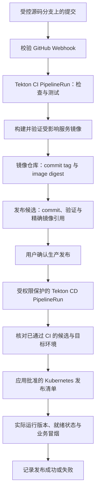

# 统一学习平台 — K3s / Tekton 部署与发布方案

- Updated: 2026-10-20
- Status: ROUTE_ACCEPTED / DETAIL_DESIGN_PENDING；K3s + Tekton 路线已由用户确认，详细实现合同尚未批准。
- 部署路线决定：[ADR-0006](../adr/0006-k3s-tekton-deployment.md)。平台设计：[平台架构方案](PLATFORM_ARCHITECTURE_PROPOSAL.md)、[ADR-0005](../adr/0005-unified-learning-platform-microservices.md)。本文件持有部署细节；平台方案 Q7 是待决入口。
- 本对话仅设计与文档。不创建 workflow、Pipeline、webhook、Secret、服务器或集群，不修改 Dockerfile / Compose，不执行构建、发布或远端写入。

## 1. 已确认的目标与成本边界

| 分类 | 内容 |
| --- | --- |
| 已确认路线 | 一期采用 K3s + Tekton，覆盖 Kubernetes 和云原生 CI/CD 学习；不购买 OpenShift 商业订阅 |
| 已确认用途 | 稳定日用，并巩固云服务器、容器、Kubernetes、Tekton 与发布排障能力 |
| 已确认发布门禁 | 自动构建、测试与生成发布候选；CI 通过后由用户确认生产发布，不采用 Push 后无人工门禁更新生产 |
| 已确认免费要求 | 工具采用免费自托管方案，不依赖付费平台订阅，不默认授权额度外付费 |
| 预算理解 | 用户表述 `v4，8g`，暂按约 4 vCPU / 8 GB 理解；不是实际容量保证，也不作为当前设计 blocker |
| 当前应用边界 | Gateway、Identity、Language、PersonalNote 四个基础服务加独立 AI 服务；内部 Dubbo RPC + Nacos 已确认，具体版本及运行配置仍待设计 |
| 当前实现边界 | 现有应用及 Compose 不因本方案视为已迁入 K3s；本轮没有集群或流水线运行证据 |

免费指软件／工具不需要购买订阅；云主机、磁盘、流量、备份等按用户后续采购处理。托管镜像仓库等若有免费额度或计费条件，必须核对；不能把免费试用当作长期免费生产方案。

当前不要求提供或购买机器、域名、IP。现在确定工具职责、发布与恢复合同；具体值在购买后填写。HTTPS、身份与数据保护要求不因此取消。

## 2. 工具职责与未选择方案

| 组件 | 一期职责 / 状态 |
| --- | --- |
| K3s | 已选：运行 Kubernetes 工作负载，学习 Pod、Deployment、Service、网络、配置与持久存储 |
| Nacos | 已选：Dubbo 注册发现，作为 K3s 中的额外组件；HTTP 入口仍可用 Kubernetes Service／DNS；不承担业务请求转发，应用配置中心与元数据中心需求另行设计 |
| Tekton Pipelines | 已选：以 Task / Pipeline 组织 CI，以及经授权的部署步骤 |
| Webhook 事件接入 | 需要此能力；Tekton Triggers 是拟采用的接入组件，具体版本、校验与 RBAC 待设计 |
| 镜像仓库 | 必需，但产品与运行位置待选；免费自托管 OCI registry 或符合免费条件的托管仓库均可评估，不默认选定 GHCR |
| Kubernetes 发布清单 | 需要版本化并与 release 对齐；使用基础 YAML、Kustomize 或 Helm 尚未决定 |
| Coolify / Docker Compose | 未选为一期生产部署平台；现有 Compose 可继续描述本地环境，不默认删除或改写 |
| GitHub Actions | 不再是一期开销与权限设计中的必需 CI 执行者；不叠加一套重复生产发布路径 |
| Argo CD | 未选为一期必需组件；Tekton 可以执行部署，是否后续采用 GitOps 独立决定 |
| OpenShift / OKD | 不是一期运行平台；K3s 学习不能直接记作已掌握 OpenShift 特有功能 |

K3s 是 Kubernetes 发行版；Tekton 提供开源 CI/CD 能力，PipelineRun 表示一次具体执行。选择工具路线不等于已安装或已掌握。[K3s](https://docs.k3s.io/)、[Tekton](https://tekton.dev/)、[PipelineRun](https://tekton.dev/docs/pipelines/pipelineruns/)

## 3. 目标发布链路

建议将自动 CI 与人工批准后的 CD 分为两次受不同权限约束的 PipelineRun，而不是让公开 webhook 直接获得生产部署权。这是详细设计候选；审批入口、release 记录位置、引用校验和执行身份仍需 Review。

用户批准的对象包含 commit、CI run、环境、服务、镜像 digest、schema / 配置影响与回退条件。CD 必须验证候选确实通过要求的 CI，不能信任调用参数中单独提供的“已批准”或任意镜像地址。

人工批准发布不等于批准代码 commit / push / merge。注册平台应用的普通用户也不自动成为 Kubernetes 操作人员。

## 4. Webhook、权限与并发

- Webhook 处理需验证来源、签名、允许的仓库／分支与事件类型；重复投递应有去重或防重复触发合同。
- 事件接入身份只创建允许的 CI 执行，不允许提交任意 Task 模板、生产凭据或部署参数。Tekton Triggers 的具体校验和授权配置另行设计。
- 构建、测试、镜像推送和生产部署应区分权限；生产 CD 使用受控身份和有限 RBAC，而不是给 CI `cluster-admin`。
- 生产发布的人工确认入口可基于受权限保护的 CLI / 管理入口设计，不默认增加一个自建审批平台，也不依赖付费审批服务。
- 同一环境同一时刻只允许受控的发布操作，拒绝旧候选覆盖更新版本；不能靠取消 PipelineRun 假定容器、migration 和外部操作都已回滚。
- 对不受信 PR 的构建，不开放生产 Secret、可写数据或部署身份。镜像构建器与容器权限待选择，不默认挂载宿主机 Docker socket。

[Triggers 官方文档](https://tekton.dev/docs/triggers/)

## 5. 镜像、清单与 Monorepo 范围

每个业务服务独立生成镜像；commit tag 用于追踪，digest 用于锁定内容。发布候选记录服务到精确 digest 的映射，未变服务可沿用上一批准引用。不能构建 SHA tag 却部署浮动 `latest`。

2026-10-20 用户确认前端采用一个 Vue 应用，按业务分区并统一构建发布（平台方案 C23），并进一步选择独立前端仓库、独立镜像构建及发布（C26），不为 Language／PersonalNote 分别发布前端。后端继续在现有仓库按服务构建发布；前端提交进入前端构建流程，不无条件重建全部后端。前后端仍需核对 HTTP API 兼容性；接口变化时明确跨仓提交、测试及协调发布范围。前端镜像内静态资源服务方式、仓库名、流水线与部署清单归属待设计，本决定不授权当前新建仓库、编写 Dockerfile、迁移源码或修改流水线。

前后端构建均沿用 Tekton 与人工生产发布门禁。发布候选除精确镜像引用外，还须记录来源仓库、commit 与 CI run，避免以单个仓库 SHA 代表两仓整体版本；跨仓发布记录明确所用组合。仅有前端兼容性变更时可以只发布前端，后端内部兼容变更可以只发布受影响服务，具体触发规则与候选验证留到流水线合同。

Kubernetes 发布清单及配置版本必须可追踪，CD 使用与候选一致的清单和镜像引用；只接收 webhook、镜像推送成功或创建 PipelineRun，都不代表新版本已部署。

| 变更 | CI / release 影响分析要求 |
| --- | --- |
| 单个服务内部代码 | 核对直接依赖，验证并构建受影响服务 |
| 统一前端代码／依赖 | 验证并构建统一前端产物，核对相关后端 API；不因此无条件重发全部后端服务 |
| 共享 RPC contract / 客户端组件 | 验证提供者与消费者，决定协调发布范围 |
| 统一父 POM、BOM、Java / Boot / Cloud 等基线 | 扩大到受影响服务，生成统一升级计划，不长期保留单服务版本漂移 |
| migration / 集群发布配置 | 数据或配置 owner Review，不只按业务目录筛选 |
| 纯文档 | 文档校验，不因此部署业务镜像 |

受影响范围由流水线设计处理，不依赖 Coolify Watch Paths。清单目录、镜像命名、release 存储与保留、Task / builder 镜像固定方式待设计；不自动让流水线向源码或部署仓库写 Git commit。

## 6. 集群、网络与数据边界

首版可按单机 K3s 讨论，但不承诺高可用、无停机或约 4 vCPU / 8 GB 足够。容量预算覆盖控制面、Tekton、构建 Pod、五个 Java 应用服务（含已选独立 AI 服务）、额外的 Nacos、数据库、Redis、入口、日志和发布峰值。机器购买参数后置，不阻塞当前设计。

构建运行位置仍待决定：同集群时建议区分 CI 与应用 namespace、ServiceAccount、权限和资源预算；这些隔离需要具体验证，namespace 本身不等于完整安全边界。不因自托管免费就让构建任务任意访问生产数据。资源不足时应讨论执行位置或并发，不自动购买额外资源。

公网只提供业务 HTTPS 入口及受保护的必要 webhook 接入；Gateway 前的集群 Ingress 与 Gateway 的应用路由职责需明确。Kubernetes API、Tekton 管理接口、Dubbo、数据库、Redis 和 Nacos 不直接对公众开放。

用户已确认 Kubernetes Service／DNS 负责 Gateway 到业务 HTTP 入口的定位，Nacos 负责内部 Dubbo 的实例注册发现；继续使用 K3s，不为同一 RPC 再配置 Kubernetes 注册中心。Nacos 自身可以通过集群内 Service／DNS 提供稳定入口；业务 RPC 由 Dubbo 客户端直连其发现的提供者地址，流量仍使用 Kubernetes 网络，不由 Nacos 转发。

因此部署清单需增加 Nacos 工作负载、访问入口、认证、资源及持久化／恢复设计；业务服务需配置注册中心地址与可达的 RPC 注册地址，协调就绪、注册及下线注销，避免过早注册或继续发布已退出实例。精确版本、端口、清单、网络策略及下线时序未锁定，当前不执行安装或配置变更。平台原有语言隔离和后端 authority 继续有效。

数据库、缓存和注册发现等基础设施与应用 release 分开管理。更新 Language 不默认升级数据库或删除存储。用户已确认平台方案 C24：首版一个 PostgreSQL 实例，Identity、Language、PersonalNote、AI 分别持有独立数据库、账号和 migration authority，Gateway 不持有业务库；目标业务主库不沿用 SQLite，现有数据及本地用户引用的迁移另行设计，当前不删除旧库。服务只能按权限操作所属数据库，跨服务数据经服务接口获取，不共享超级用户账号或建立跨库外键。共享实例仍有共同故障、连接数和资源竞争，需统一预算连接池及备份恢复，不视为物理隔离或高可用。PostgreSQL、PersonalNote 正文及学习记录等仍需细化持久化、权限与备份合同；正文／快照文件／向量存储位置和 PostgreSQL 具体版本未因此锁定。C24 不自动决定 Nacos 等基础设施的内部存储。

健康检查区分启动、就绪与存活；滚动更新、优雅停止和 schema 兼容需联合验证。暂不设定副本数、停机或资源数值，也不把 Kubernetes 的滚动更新能力直接等同于本项目零停机保证。

## 7. 凭据归属

| 凭据 | 目标约束 |
| --- | --- |
| GitHub Webhook secret | 受控事件接入；不记录或回显 |
| 私有代码读取身份 | CI 只取得所需仓库读取权限；不自动获得 Git 写入权 |
| 镜像推送／拉取 | CI 推送与应用拉取分开授权，仓库成本与访问范围待定 |
| Kubernetes CD 身份 | 仅受批准的发布步骤使用，限制环境与可操作资源 |
| 数据库与运行 Secret | 受控 runtime 凭据，不进镜像、Git 或构建日志；Kubernetes Secret 的使用不自动构成加密与访问控制方案 |
| 私人 Vault 凭据 | PersonalNote runtime 的限定只读凭据；不让构建任务读取私人 Vault 或把快照打进镜像 |
| 全平台模型 BYOK | 本人和朋友各用自己的模型 Key，Language / PersonalNote / AI 服务不提供公共模型额度或平台 Key 回退；后端临时使用，不持久化为共享集群 Secret、流水线参数、Nacos 配置、数据库、Redis、日志／Trace 或持久化 Job；具体传递及异步合同待设计 |

不在日志、构建产物、release 记录或通知中输出 token、私人正文与完整 Prompt。SAA 的工作流也不能调用部署接口获得生产写权限。

## 8. 成功、失败与回退

成功条件：CI 与 CD 达到正确终态；实际运行镜像与批准候选一致；工作负载就绪；关键业务冒烟通过。触发被接受不等于执行成功，Pod Running 不等于业务可用。

冒烟需包含身份接口、未登录拒绝、未授权应用拒绝、Language 入口和本人笔记边界。采用受控测试身份和非私密数据；live Provider 不作为每次发布的必需项。

Deployment 修订回退或重部署旧镜像不会恢复数据库 migration、PVC 数据或外部状态，也不保证恢复了配套 ConfigMap / Secret。应保留可追踪的旧清单、镜像和配置引用，先核对 schema / 配置兼容再回退。

破坏性 schema 变更、恢复旧数据库、删除 PVC 等需要单独决定，不成为失败后的默认自动动作。备份至少覆盖 PostgreSQL、PersonalNote 正文和不可重建学习记录；可重建快照／索引与不可重建状态分别定义恢复方式。RPO、RTO、保留周期与恢复演练待设计。

[Kubernetes Deployment 与回退](https://kubernetes.io/docs/concepts/workloads/controllers/deployment/)

## 9. 学习范围与验收

已选路线覆盖 Linux / SSH 与权限、容器镜像与仓库、Kubernetes 工作负载／网络／存储／RBAC、Tekton Task / Pipeline / PipelineRun、Webhook、发布、日志排障及备份恢复。

后续建议以真实操作和受控故障演练形成学习证据：追踪一次 CI 到发布、修改关键配置、定位一次构建或启动失败、验证权限拒绝、回退应用、恢复测试备份。不能把 Agent 代操作或工具安装完成直接记作用户已掌握。

不将 K3s / Tekton 实践等同于 OpenShift 的 Route、SCC、Operator 或产品运维经验；若要进一步学习 OpenShift，另设免费环境与 Scope。

## 10. 待决事项与验证状态

已确认：K3s + Tekton 一期路线、免费工具要求、人工生产发布门禁、机器与域名后置。Coolify 和 GitHub Actions 已从一期默认链路移出，不再把路线选择标为待确认。

当前仍需设计：K3s / Tekton / Triggers 版本、触发器与审批入口、镜像仓库及免费条件、构建器、执行位置与权限、namespace / 网络 / 存储、发布清单格式、release 记录、受影响范围、schema 顺序、恢复和容量合同。用户已改为优先考虑较新技术，允许预发布候选，仍不接受已停止维护的版本；免费维护、兼容及升级要求见[平台方案 §5](PLATFORM_ARCHITECTURE_PROPOSAL.md#5-统一技术版本基线)，不因允许预发布而自动选定部署组件版本。沿用 DailyLanguage 单仓库、独立 AI 服务及全平台 BYOK 已确认。共同应用版本 Q1、AI 接口、具体凭据传递与 workflow 分工仍待逐项解释和决定。

购买后填写服务器、域名、IP、证书、实际磁盘和网络规则，不作为当前设计 blocker。精确组件版本与能力在实现前核对；本轮不生成配置或执行实验。

后续获批后验证：未通过 CI 不生成可发布候选；无人工批准不发生产；webhook 认证与重复投递；CD 权限边界；digest 不漂移；并发不倒退；构建与生产隔离；就绪／业务故障；schema 兼容回退；备份恢复与资源峰值。

本轮仅设计、文档与官方资料核对。集群、Pipeline、webhook、镜像构建、生产发布、容量及恢复演练全部 NOT_RUN。
