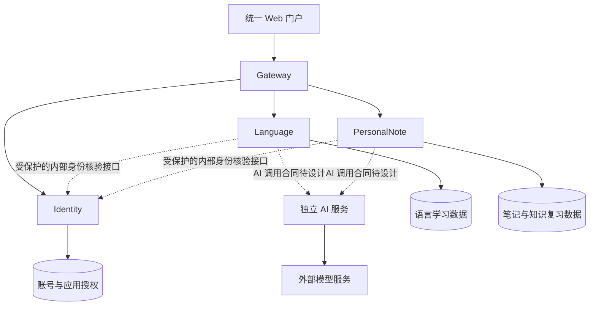

# 统一学习平台 — 架构变更方案

- Updated: 2026-10-21
- Status: DRAFT / DESIGN_REVIEW；部分产品与架构方向已由用户确认，完整方案未最终批准。
- 当前 Scope：迁移前文档收口；不修改业务代码、dependency、构建或部署配置，不执行数据库迁移或服务搬迁。此前 C31 已单独获准并完成隔离验证，最新事实见 §9.3；正文带日期的“未运行”保留为当时的历史记录。
- 决策入口：[ADR-0005](../adr/0005-unified-learning-platform-microservices.md)。本文件持有设计细节；ADR 记录决定及其状态。
- 部署与 webhook 发布细节见 [部署架构方案](DEPLOYMENT_ARCHITECTURE_PROPOSAL.md)；用户已选 K3s + Tekton 一期路线及人工生产发布门禁，决定见 [ADR-0006](../adr/0006-k3s-tekton-deployment.md)，详细实现仍待 Review。
- 本文描述未来目标，不证明微服务、统一权限或 Spring AI Alibaba 已实现；现有代码与既有正式合同继续描述当前行为。
- 主要业务流程、当前实现边界及 AI／领域分工候选见[流程与服务职责讨论稿](PLATFORM_WORKFLOW_RESPONSIBILITIES.md)；覆盖既有及正式规划流程，新的具体分工仍待用户决定。

## 1. Current Situation / 当前情况

2026-10-19 只读核对：

| 项目 | FACT | 局限与 UNKNOWN |
| --- | --- | --- |
| DailyLanguage | branch `feature/m1s11-VuePracticeUX`，HEAD `a486ef7fd65925d9536620de53df7a1c37bad892`；本轮开始时 worktree clean；Java 25 / Spring Boot 4.1.0 | `CURRENT_HANDOFF` 和 `PROJECT_STATUS` 落后于 Git / S11-B Feature 合同，不能用于授权下一实现动作；本轮未重跑测试 |
| Language 已有能力 | 账号与密码验证、Redis Session、最小 Vue 认证 UI、Planner / Practice / Evaluator、Model Gateway / ModelCallJob 等代码已存在 | 不代表完整语言产品闭环完成；S11-C / S12 不因本方案自动启动 |
| PersonalNote | 独立同级目录；Java 25 / Spring Boot 3.5.16；工程骨架、Obsidian 快照与原文 API 已存在；目录尚不是 Git repository | SPEC 记录 S1a REVIEW_PENDING；检索、Native Notes、AI 问答及复习尚未实现；不自动更改其 Review Gate |
| 数据与权限 | Language 的多个表关联本地 `app_user`；PersonalNote 当前快照未按平台用户分区；用户确认当前账号、学习记录及笔记快照仅为测试数据，可讨论重建 | 测试数据性质为用户说明，未读取实际数据库账号、数据量或备份；管理员身份绑定与重建范围仍待设计，未授权清库 |

## 2. Problem / 为什么改变

用户希望将两个应用整合为统一入口、统一账号与授权的平台，同时以真实功能学习 Spring Cloud、Dubbo 和 Spring AI Alibaba；首版主要本人及少量朋友使用。

问题包括：原有单用户／无用户入口无法直接满足平台权限；版本基线不同；账号与业务表存在本地关系；模型调用的复用方式尚未决定。

主要收益是学习、独立部署和业务边界清晰。本轮没有性能瓶颈证据，不将微服务描述为已证明的性能优化。

## 3. 已确认决定与未批准内容

| 编号 | 用户已确认的方向 | 边界 |
| --- | --- | --- |
| C1 | 统一门户：登录后选择要使用的应用 | 仅展示已获授权入口；界面隐藏不能替代后端鉴权 |
| C2 | Gateway、Identity、Language、PersonalNote，以及独立 AI 服务 | 四个基础服务之外新增独立 AI 服务的部署方向已确认；Language 内部模块先保持完整，不默认把 Planner / Evaluator / Memory 再拆成独立进程 |
| C3 | 朋友自行注册，新用户注册成功后默认获得 Language 访问权限，无需管理员逐个批准 | 仅默认授予 Language；PersonalNote 仍首版仅本人可用；管理员可撤权或停用账号，登录不能重新补回已撤销权限；注册、登录与应用授权仍是不同事实 |
| C4 | PersonalNote 首版仅本人可用 | 不批准朋友笔记空间或笔记共享功能 |
| C5 | 首版集中管理 Cookie Session | OAuth2 / OIDC 不纳入本次迁移；内部身份合同仍需设计 Review |
| C6 | AI 框架采用 Spring AI Alibaba，放在独立 AI 服务 | 模型凭据统一 BYOK，见 C16；具体版本、接口、凭据传递与 workflow 持有边界、Graph 使用范围仍需 Review，不因独立部署而默认迁走全部业务流程 |
| C7 | Java、Spring Boot、Spring Cloud 等采用统一技术基线 | 不以长期混合 Boot 版本规避依赖兼容问题；具体版本尚未选择 |
| C8 | 本对话仅设计与文档工作 | 不执行上一轮提出的 MIG-P0A，也不将其标记为已批准实现 |
| C9 | 首版稳定日用，采用 K3s + Tekton 巩固云服务器、Kubernetes / 容器与 CI/CD；CI 通过后由用户确认生产发布 | 见 ADR-0006；约 4 vCPU / 8 GB 仅预算理解，机器与域名后置；Coolify / Actions 不再是一期默认路线，镜像仓库与实现细节待设计 |
| C10 | 部署工具采用免费方案 | 免费自托管优先，不依赖付费平台订阅；托管免费额度与超额付费边界需明确；不承诺基础设施免费，也不默认开放额外计费 |
| C11 | 优先考虑较新的技术版本，允许预发布版本，不接受已停止维护的版本 | 用户已取消“仅正式版”限制，并非只对 AI 例外；逐项核对免费维护、兼容依据与升级影响，不能以付费延长支持代替；允许评估不等于已锁定具体版本 |
| C12 | 沿用 Language Learning 仓库（当前 DailyLanguage），未来将 PersonalNote 后端放入其中 | 后端多个独立服务采用 Monorepo；前端按 C26 独立仓库。具体目录、导入及历史保留策略待设计，不执行源码移动 |
| C13 | 平台名称暂记为 PersonalHub，进入代码修改阶段再调整 GitHub 仓库名与本地目录名 | 当前不重命名；最终名称、仓库 slug、目录大小写及具体实施 slice 待确认，保留现有仓库与 Git 历史；不自动扩大为 Java package、服务注册名或数据库重命名 |
| C14 | Identity 统一管理平台账号、登录及应用授权；业务数据由各业务服务管理，通过固定 `userId` 关联 | 用户已认可身份迁移方向；若保留既有账号与记录，应保留 UUID 及归属，测试环境重建另见 C15；历史单用户数据如保留需明确绑定本人，不自动绑定首个注册者；具体表迁移、Session 验证与内部调用合同仍待设计，不授权实际迁移 |
| C15 | 当前账号、学习记录及笔记快照仅为测试数据，可按目标平台重建；2026-10-20 用户补充旧环境是否保留并不重要，不再将保留旧运行环境作为迁移硬要求 | 取代此前“旧环境暂保留”的必需前提，可按明确范围重建测试账号／数据，不要求保留旧测试 UUID／历史。是否短暂保留对照、具体初始化与清理操作在迁移合同中决定；当前不执行删除。源码、Git 历史、凭据和 GitHub 原始 Vault 不因测试数据可重建而成为删除对象 |
| C16 | Language、PersonalNote 及独立 AI 服务的模型调用统一 BYOK；本人和朋友均使用自己的模型凭据，平台不提供公共模型额度 | 不共享本人 Key，不设置平台 Key 作为缺省或失败回退；后端临时使用，不落数据库、Redis、日志或持久化 Job；具体传递、客户端保管、无 Key 交互及异步调用合同待设计；不改变 GitHub／数据库等其他凭据归属 |
| C17 | 以练习评价确认执行／消费分工：AI 持有可查询的模型执行结果；Language 持有业务消费结局，并与评价结果在本地事务中一起提交 | 用稳定业务任务／执行 ID 关联并去重，AI 不持有业务消费成功真相；不默认另存跨事务“消费中”；具体接口、schema、结果保留与恢复合同待设计，不代表所有 workflow／Graph 分工已批准 |
| C18 | 通信方案采用 Gateway 对外 HTTPS、Gateway 到业务入口 HTTP、内部 Dubbo RPC + Nacos 服务发现，继续部署在 K3s | Gateway 的 HTTP 目标通过 Kubernetes Service／DNS 定位；Dubbo 的实例发现由 Nacos 负责，不给同一 RPC 再叠加 Kubernetes 注册中心；Nacos 是地址信息服务，不转发业务 RPC；精确版本、协议、身份与网络配置仍待设计 |
| C19 | 每位用户在自己的设备上配置并持久保存模型设置及 Key，按业务用途／能力自动选择；缺 Key 时提示并引导配置页。允许调用时加密传给平台，由后端临时使用 | 用户已选择设备保存、服务端临时调用的方向，不要求 Key 完全不经过网络。禁止平台持久化及泄露；Cookie 不作为模型 Key 的存储方案。具体设备存储、账号隔离、保护／解锁、路由校验和临时传递合同待设计；语音／图像／视频分类不代表相关业务能力已批准实现 |
| C20 | 内部服务身份认证与传输保护采用 mTLS，作为学习与平台安全方案的一部分 | 服务证书身份还须绑定可调用操作，不替代用户会话与资源授权；私有 CA、证书签发／续期／撤销、TLS 终止位置及各协议配置仍待设计，不自动引入证书管理组件或批准实施 |
| C21 | 用户暂定首版由接收服务通过受保护的 Identity 接口在线核验 Session、账号状态及所需应用授权，再由业务服务检查资源归属；不信任客户端自报 `userId` | 这是可复审的首版设计选择，不代表用户已具备实现或 Review 经验证据；首版不缓存授权结果，核验基础设施故障时拒绝放行。具体凭据传播、接口、超时与异步合同仍待设计，不授权实现 |
| C22 | 首版 AI 任务由用户触发，已接收并启动的任务可在限定时间内后台执行；恢复时优先查询已有结果，执行情况不明时不盲目重新调用模型 | 已保存结果的查询不需要模型 Key，但仍需身份与资源授权。明确尚未调用模型的任务可在用户返回、客户端自动提供本地凭据且授权通过后继续；未知执行须先尝试安全查询，无法确认时由用户决定是否创建新执行。具体时限、恢复与供应商能力合同待设计，不承诺设备离线且服务重启后的无人值守恢复，不引入持久化 Key 或自动选定任务中间件 |
| C23 | 首版采用统一 Vue 前端，按平台公共功能、Language、PersonalNote 分区；前端统一构建发布，后端各服务独立发布 | 用户前端学习重点是开发语言与基础能力，结合实际功能学习 TypeScript、JavaScript、HTML/CSS 和 Vue；不引入微前端。具体目录、路由、公共组件、工具版本与静态产物托管方式待细化，不授权当前迁移或前端功能实现 |
| C24 | 首版共用一个 PostgreSQL 实例，Identity、Language、PersonalNote、AI 各持有独立数据库、专用账号与 migration authority；禁止跨服务直接读写表 | Gateway 首版不持有业务库；跨服务数据通过服务接口获取，不建跨库外键，不将本地事务外推为跨库事务。共享实例不提供物理故障隔离；版本、库名、账号权限、连接池、备份恢复及迁移细节待设计，不授权当前建库、改表或删除旧数据 |
| C25 | 迁移按共同版本与基础合同 → 建立 Identity → PersonalNote 最小只读认证接入 → Language 身份与本地数据引用切换 → 扩大 PersonalNote 与 AI 迁移的顺序推进 | 先建立 Identity 不等于首轮完整拆完 Language；PersonalNote 作为首个业务验证对象。仅确认路线与验证目标方向，工作组仍须拆成小 slice；精确目录、共享模块、接口及首个验证合同待审，当前不授权代码、实验、建库或搬迁 |
| C26 | 统一 Vue 前端放入独立 Git 仓库，独立提交、构建镜像与发布；现有仓库继续管理全部后端微服务 | 用户希望前端提交与镜像构建影响范围更直观；具体范围由流水线控制，API 变化仍需兼容验证及必要协调发布。两仓沿用 K3s + Tekton 与人工生产发布门禁，不改变统一入口／一个前端；仓库名、前端迁出及历史处理待实施合同，不授权当前新建仓库或移动源码 |
| C27 | 每个后端运行服务对应一个 Maven 模块；RPC 合同独立为最小 Java library，只共享接口、必要 DTO 与结果语义；根 POM 统一版本，服务按需声明依赖；合同变化检查消费者兼容及发布范围 | 不共享 Entity、Repository、业务规则或认证实现，不建立服务实现 JAR 之间的依赖，不预建大 common 模块。首轮按需建立身份合同，AI 合同随对应迁移获批后建立；精确类名／字段、版本、坐标和实施文件待细化，当前不创建模块或修改依赖 |
| C28 | Java 25、Spring Boot 4.1.1、Spring Cloud 2025.1.3 确认为首选基础目标；BOM 管理组件随目标基线，不逐个追新覆盖 | 不等于已锁定完整生产组合；SAA、Dubbo、Nacos 的具体配套与部分维护证据仍待核验。当前不修改依赖或运行实验；若后续需调整目标版本，另行说明影响并由用户决定，不静默降级或长期混用 Boot |
| C29 | Dubbo 选型服从已确认的免费维护与统一版本要求；若无法满足，则重新比较 gRPC 或 Spring HTTP Service Clients，不为保留 Dubbo 长期采用停止维护的依赖 | 用户已确认该取舍原则；当前仍沿用 C18 的 Dubbo + Nacos，兼容未知不等于已证实不兼容。后续提交核验结果、替代方案及影响，由用户决定是否切换；不自动更换框架、引入新依赖或撤销 Nacos |
| C30 | 保留 C28 基础目标与 Dubbo 方向，将兼容问题留到后续获批验证／实施阶段定位处理，不因当前支持声明不完整而预先回退 Boot | 接受兼容待验证的不确定性，不等于已验证兼容或选定 SNAPSHOT／未合并补丁；遇到错误先复现和定位，范围内修复按 slice 执行，版本回退、维护 Dubbo fork 或通信框架切换仍须提交影响并由用户决定。当前仅补充设计文档，不开始实验 |
| C31 | 首轮技术验证限定为两个最小 Boot 应用，验证共同基线下的 Dubbo RPC、Nacos 注册发现、mTLS 与有界故障处理；先用本机 Java 进程和容器中的 Nacos | 原合同见 §9.2，补丁版已完成隔离验证，最新证据及本地学习授权见 §9.3。官方原版仍失败；不证明 Identity、业务权限、SAA 或生产部署。用户明确验证工程代码不提交，不自动进入 Identity |

以下章节中的建议与候选不自动成为批准决定。Architecture、Scope、Commit Decision 仍由用户负责。

## 4. Proposed Change / 目标边界



| 服务 | 持有的 authority / 数据 | 不持有 |
| --- | --- | --- |
| Gateway | 对外路由、入口安全检查、请求关联信息 | 业务状态、账号真相、笔记归属判断 |
| Identity | 平台用户身份、登录凭据、会话、账号启停、应用授权、管理员资格 | 语言掌握度、笔记正文、语言或知识复习状态 |
| Language | `languageProfileId` 归属、训练、评价、Evidence、学习状态、相关事务与业务 Job | 平台密码、平台应用授权的第二套真相 |
| PersonalNote | 笔记来源与正文、快照、检索权限、引用验证、Native 写入、知识复习 | 平台密码、语言学习状态 |
| AI 服务 | 已确认独立部署并接入 SAA，模型调用统一使用当前用户的 BYOK；模型接入、执行及接口的职责细节待 Review | 不自动取得领域长期状态、任意写入或部署 authority；不提供公共模型 Key 或跨用户复用凭据，具体凭据传递和 workflow 分工仍待设计 |

Spring Cloud Gateway 承担入口；用户已确认内部 Dubbo RPC + Nacos 服务发现，继续以 K3s 运行服务。Gateway 到各业务 HTTP 入口通过 Kubernetes Service／DNS 定位；内部 Dubbo 调用通过 Nacos 取得提供者地址后直接连接目标实例，不把 Nacos 当成业务代理或所有请求必经节点。同一 RPC 的实例发现不再同时配置另一套 Kubernetes 注册中心。Spring Cloud Alibaba 不因名称、使用 Nacos 或选用 Spring AI Alibaba 而自动整体进入依赖范围。

K3s／Kubernetes 继续负责容器调度、Pod 网络、Service／DNS、探针及生命周期；Nacos 作为额外运行组件，维护 Dubbo 注册和订阅信息。二者可以共用，Nacos 不接管容器 IP 分配或底层网络。后续需确定 Nacos 的集群内稳定访问入口、认证及资源／持久化配置，确保 Dubbo 注册地址可被调用者访问，并设计 Pod 启停与注册／注销的协调；不能把 localhost 或仅宿主机可达的地址误注册给集群调用方。具体地址、端口和清单仍未生成。

2026-10-19 官方依据：[Dubbo 在 Kubernetes 中使用 Nacos 注册中心](https://dubbo.apache.org/en/overview/mannual/java-sdk/tasks/deploy/deploy-on-kubernetes/)、[Dubbo 控制与调用职责](https://dubbo.apache.org/en/overview/what/overview/)、[Kubernetes Service](https://kubernetes.io/docs/concepts/services-networking/service/)。选择 Nacos 注册发现不自动确定应用配置中心、Dubbo 元数据中心或引入其他治理组件；这些需求若出现需单独设计。发现到地址不等于调用者身份可信，内部认证合同仍待 Review。

所有服务独立构建、启动与部署。用户选择沿用 Language Learning 仓库（当前 DailyLanguage），PersonalNote 后续纳入该仓库；Monorepo 指一个 Git repository 保存多个服务源码，不等于合为一个运行进程。具体目录布局及导入方式候选见 §4.1，尚待 Review；保留现有 Git 历史，不自动重命名、移动或复制源码。父 POM / BOM 集中管理版本，各服务只声明所需 starter，不要求每个服务加载 Cloud、AI 或数据库组件。

平台名称暂记为 **PersonalHub**；DailyLanguage、PersonalNote 可继续作为各业务应用名称。用户明确将 GitHub 仓库及本地仓库目录的重命名留到代码修改阶段，当前只记录意图。实施前确认最终名称、仓库 slug 与目录拼写，并核对 remote、现有路径引用、文档链接及届时已有的 CI / webhook 配置；保留现有 Git 历史。该计划不自动授权 Java package、Maven 坐标、`spring.application.name`、数据库或服务发现标识的一并重命名，影响范围在对应 slice 单独明确。待办见 [IDEA-015](../planning/BACKLOG.md#idea-015--rename-platform-repository-and-local-directory)。

### 4.1. R0 目录与共享代码设计稿（部分选定 / DESIGN_REVIEW）

本节是 C25 路线下的 R0 设计材料；C26 前端独立仓库和 C27 后端模块／合同共享规则已获确认，精确目录拼写、坐标、接口字段与导入实施合同仍待细化。2026-10-20 只读核对：当前后端 Maven 入口为 `server/pom.xml`，仓库根目录尚无 `pom.xml`；前端现有入口为 `client/package.json`，PersonalNote 独立入口为 `backend/pom.xml` 与 `web/package.json`。本轮不创建 POM、不安装依赖、不移动或导入源码。

用户比较后已选择前端独立仓库（C26），后端继续 Monorepo。C23 的“一个统一 Vue 应用、前端统一发布”继续有效；以下按两仓边界调整目录草图，但不把具体目录名或新仓库名一并视为已批准，详见 §4.1.6。

#### 4.1.1. 目标布局与模块职责

后端仓库聚合后端服务与 RPC 合同，前端独立仓库管理统一 Vue 应用。现有 `client/` 是迁移来源，不再作为目标后端仓库的正式前端目录。下图描述目标职责，不要求首轮创建所有空目录／模块；实际节点按获批 slice 逐步出现。

```text
<后端仓库>/
├── pom.xml                      # Maven 聚合入口及统一父 POM
├── services/
│   ├── gateway/                  # 统一 HTTP 入口与路由
│   ├── identity/                 # 平台账号、会话及应用准入
│   ├── language/                 # 语言学习业务，内部模块保持完整
│   ├── personalnote/             # 笔记业务与只读来源
│   └── ai/                       # 模型执行及可查询结果
├── contracts/
│   ├── identity-api/             # 首条身份 RPC 所需接口和 DTO
│   └── ai-api/                   # AI 接口获批时再创建
├── deploy/                       # 后续获批的本地／K3s／Tekton 配置
└── docs/                         # 保留现有文档与决定入口

<独立前端仓库>/
├── package.json                  # 独立 Node 构建与依赖
├── <依赖锁文件>                  # 工具及文件名在前端合同中明确
├── src/                          # 门户、Language、PersonalNote 与模型设置
└── <其余前端配置与资源>           # 镜像、流水线及部署清单归属另行细化
```

每个实际后端服务是一个可独立启动的 Maven module，拥有自己的配置、源代码、测试和数据库 migration；不再默认把其内部拆成 domain / application / infrastructure 多个 Maven module。既有 package 内部分层可以保留。`contracts/*` 是普通 Java library，不启动服务、不连接数据库、不持有私钥／凭据，也不打包为 Spring Boot 可执行应用。前端使用 Node 构建，首版不要求绑入 Maven 生命周期。

当前解决的边界是独立运行服务与 RPC 调用合同，不是为未来扩展预建框架。首轮需要的服务／合同逐项建立即可；没有确认的 RPC 提供者时，不提前创建 `language-api`、`personalnote-api` 或通用 `common` 模块。

#### 4.1.2. 允许的编译依赖与运行调用

下表区分 Maven 编译依赖和网络调用，避免把 Dubbo 调用实现成依赖另一个服务的实现 JAR。

| 模块 | 允许的合同依赖／运行职责 |
| --- | --- |
| Identity | 编译依赖 `identity-api`，实现身份核验；自行持有账号、密码验证、Session 与授权持久化 |
| PersonalNote | 编译依赖 `identity-api`，经 Dubbo 调用 Identity；自己的 HTTP Controller、笔记模型与存储留在本服务 |
| Language | 切换身份时依赖 `identity-api`；迁移模型执行时按已审 AI 合同依赖 `ai-api`，不提前加入空依赖 |
| AI | 业务接入时依赖 `ai-api`，按 C21 接入身份核验所需 `identity-api`；不依赖 Language／PersonalNote 实现 |
| Gateway | 按配置经 HTTP 路由到服务，不因路由需要而依赖各服务的 Controller、Entity 或 Repository |
| 独立前端仓库 | 使用 HTTP API，不依赖 Java JAR；TypeScript 请求／响应类型在前端管理，自动代码生成另行评估 |

`services/*` 之间不建立实现模块依赖，`contracts/*` 不反向依赖服务实现；身份合同不依赖 AI 合同。未来合同之间若出现依赖，先确认真实语义，不提前建立通用共享领域模型。各服务仍可有自己的 Java 包和内部类型，不要求为了字段相似而统一继承。

#### 4.1.3. 合同共享到哪里为止

以首条身份核验 RPC 为例，`identity-api` 只容纳方法签名、必要请求／响应 DTO 及双方必须理解的有限结果语义；不在这里实现认证或授权逻辑。具体类名、字段、超时和错误映射在首个验证合同中 Review。会话凭证如需出现在请求中，仍属敏感值，不得通过 DTO 的自动 `toString()`、日志或 Trace 泄露；业务接口所需 appCode／操作权限由服务端规则限定，不能由客户端任意降低。

| 可以共享的合同内容 | 留在所属服务内的实现 |
| --- | --- |
| RPC interface、必要 DTO、稳定的有限结果语义 | Controller、Application Service、领域规则及状态转换 |
| 当前核验所需的用户标识和准入结果 | 用户 Entity、账号 Repository／Mapper、密码散列与注册事务 |
| 模型任务／结果接口所需的信息，待 AI 合同批准 | Language 的任务、评价、学习记忆 Entity 与消费事务；PersonalNote 的快照、索引与写入规则 |

认证消费者从受保护的 Identity 核验结果建立自己的请求身份，不通过共享序列化 Spring Security 对象或完整 `SecurityConfiguration` 获得身份。HTTP 过滤器、RPC 接入与错误响应各有边界，首版先保持显式；出现真实且稳定的重复后再单独评估共享组件，不自动新增安全 starter、AOP 或统一业务基类。

#### 4.1.4. 父 POM、构建与发布

按已确认的 C27，仓库根 POM 承担 Maven 聚合与父级版本管理，不运行生产服务。集中管理 Java 编译基线、共同依赖版本和构建插件版本；根 `dependencies` 不向所有模块强制引入 Web、数据库、Redis、Dubbo 或 AI starter。服务在自己的 POM 声明真实所需依赖；合同保持最小依赖，Spring Boot 可执行打包只应用于运行服务。具体 BOM 导入／覆盖次序和 Maven 版本在共同版本设计中确定，不用父 POM 掩盖兼容冲突。

独立构建服务时，构建器仍需取得它依赖的合同 library；可由 Maven reactor 同时构建必要依赖，不等于编译或发布所有应用。只修改 Identity 内部实现且合同兼容时，可只发布 Identity；修改 `identity-api` 时必须核对消费者兼容及回归范围，再决定是否协调发布，不将“同仓库可一起改”视为可任意破坏接口。首版不要求为内部 library 建立额外远程制品服务。

官方机制依据：[Maven 多模块与 reactor](https://maven.apache.org/guides/mini/guide-multiple-modules.html)、[dependency management](https://maven.apache.org/guides/introduction/introduction-to-dependency-mechanism.html)、[Spring Boot 可执行打包](https://docs.spring.io/spring-boot/maven-plugin/packaging.html)。引用说明构建机制，不证明候选版本或目标工程已经构建通过。

#### 4.1.5. 从当前目录逐步落地与 Review 范围

建议在实施阶段按 C25 路线逐步落地：先建立获批的父级构建和首条 Identity 合同／服务，再将 PersonalNote 接入首轮验证；Language 切换 slice 才处理 `server/` 的目标归属和用户引用。过渡阶段当前 `server/` 可保留为旧环境对照，但新平台中同一功能不能同时由两个运行服务持有认证或业务写入真相；何时复制、迁移与停止旧入口在各 slice 明确。

PersonalNote 按审阅后的清单导入源码、测试及必要资源；不整体搬入 `.env`、凭据、运行数据、`node_modules`、`target`、`dist` 等本地内容。按更新后的 C15，不要求同时运行旧环境或保留旧测试数据；具体清理对象与时点仍在迁移合同明确，导入不等于删除来源源码。前端按 C26 将现有 `client/` 与 PersonalNote 所需页面／组件整合到独立的统一前端仓库，不同时维护两套正式平台前端；何时停止维护旧目录、保留哪些历史在迁移合同中确定。

目录整理与 GitHub／本地仓库改名、Java package／Maven 坐标修改分开 Review；此设计不锁定新 groupId、服务注册名、数据库名或具体移动操作。不因目录草图提前更新所有历史路径或既有实现 Flow。模块与最小合同共享规则已按 C27 确认，不再重复请求选择；仍须收敛精确路径、共同版本与首个验证合同，再批准任何代码／实验。

#### 4.1.6. 前端独立仓库（C26 已确认）

用户已选择原候选 B：现有平台仓库管理全部后端服务，另建独立统一前端仓库，覆盖门户、Language、PersonalNote 与模型设置。前端有独立提交、依赖锁文件、镜像构建与发布候选；后端按受影响服务构建和发布。同仓候选 A 不再作为当前推荐或待决项，不重复请求选择。

用户希望前端提交和镜像构建影响范围更直观。该边界由两仓及各自流水线合同共同落实，不仅依赖 Git 仓库分开：前端提交走前端构建，不无条件触发全部后端镜像；后端内部变更走受影响服务验证，涉及 HTTP API 时核对前端兼容。跨仓变更关联两个仓库的提交／PR、接口合同和精确镜像引用，不默认一次前端变更需要部署全部后端，也不承诺接口变化可以完全独立发布。

前端仍以 TypeScript／JavaScript、HTML/CSS 和 Vue 为学习重点，不引入微前端；两仓继续使用已选 K3s + Tekton 路线和人工生产发布门禁，不因此新增 GitHub Actions 发布链。具体新仓库名、源码／历史迁出方式、HTTP 合同维护及流水线／清单归属仍待设计；当前不创建仓库、拆分历史或修改 remote。

仓库数量与浏览器同源是不同边界。即使采用 B，仍可部署为同一个 HTTPS 站点，由同源路径提供前端和 Gateway API；是否需要 CORS／跨站 Cookie 设计取决于实际协议、主机与端口，不由 Git 仓库数量决定。[同源机制依据](https://developer.mozilla.org/en-US/docs/Web/Security/Defenses/Same-origin_policy)。两种方案都须保留 Cookie Session、CSRF 与本地凭据保护设计。

## 5. 统一技术版本基线

统一是目标约束，当前两个项目版本不同是迁移前事实，不是目标方案。统一范围建议包括 Java major / toolchain、Boot 精确版本、Cloud release train / BOM、Dubbo、Spring AI Alibaba 及其匹配的 Spring AI / Extensions；JDK vendor / patch 与镜像 tag 在部署设计中固定。

用户已更新版本选型约束：优先考虑较新的技术，取消“不接受预发布版本”的规则，允许将 Milestone / RC 等预发布版本纳入候选；该调整适用于版本选型整体，不仅是 AI 框架例外。仍不接受已停止维护的版本，具体版本尚未锁定。发布阶段、官方仍维护、组件兼容、项目验证通过是四个不同判断，不能相互替代。结合既有免费方案要求，必须核对免费维护渠道，不能以仅付费可获得的延长支持满足维护要求。预发布版本需说明 API / 配置变动、依赖适配及后续升级影响；不因版本号更新就自动选择，也不将活跃开发直接当作某个旧预发布 tag 仍受维护的证明。维护状态 UNKNOWN 的候选保持待核对，不作为已合格组合；实施前重新核对状态与维护期限。

### 5.1. 官方维护与兼容证据（2026-10-20 复核）

| 发布线 | 官方 OSS 支持截止日 | 按已确认约束判断 |
| --- | --- | --- |
| Spring Boot 4.1.x | 2027-07-31 | 可作为候选；官方当前正式版 4.1.1 支持 Java 17～26 |
| Spring Boot 4.0.x | 2026-12-31 | 尚受维护，官方 API 当前 OSS patch 为 4.0.8；剩余窗口短，暂不推荐作为本次新基线 |
| Spring Boot 3.5.x | 2026-06-30 | 免费维护已结束，排除；商业延长支持不满足免费方案要求 |
| Spring Cloud 2025.1.x | 2027-07-31 | 可作为候选；2025.1.3 正式发布并明确兼容 Boot 4.0.x / 4.1.x |
| Spring Cloud 2025.0.x | 2026-06-30 | 免费维护已结束，排除 |
| Spring AI 2.0.x | 2027-07-31 | 2.0.1 是正式版，官方支持 Boot 4.0.x / 4.1.x；不等于 SAA 已兼容 |
| Spring AI 1.1.x | 2026-06-30 | 免费维护已结束，排除；不能仅因文档标为 Stable 就判定仍受免费维护 |

支持期限来自 Spring 官方 API 的 `ossSupportEndDate`：[Boot](https://api.spring.io/projects/spring-boot/generations)、[Cloud](https://api.spring.io/projects/spring-cloud/generations)、[AI](https://api.spring.io/projects/spring-ai/generations)。2026-10-20 已重新通过只读 HTTPS 请求解析核对，未关闭证书校验；本次是资料查询，不是依赖解析或运行实验。版本及兼容依据：[Boot 系统要求](https://docs.spring.io/spring-boot/system-requirements.html)、[Cloud 兼容表](https://spring.io/projects/spring-cloud/)、[Cloud 2025.1.3 正式发布](https://spring.io/blog/2026/08/20/spring-cloud-2025-1-3-has-been-released/)、[Spring AI 入门与版本](https://docs.spring.io/spring-ai/reference/getting-started.html)。期限是本次官方数据快照，不保证未来不变，实施前重新核对。

### 5.2. Spring 首选基础目标（C28 已确认，完整配套待核验）

用户已确认 Java 25、Boot 4.1.1、Cloud 2025.1.3 为首选基础目标（C28），其余待核验组件不因该确认自动成为已合格配套。Language 当前 Boot 4.1.0、PersonalNote 当前 Boot 3.5.16 继续作为迁移前事实，不在本轮修改。

| 组件 | 推荐候选 / 管理后的版本 | 版本管理与边界 |
| --- | --- | --- |
| Java | 25 | 延续两个项目现有 major；JDK 发行方、patch 和容器镜像待选 |
| Spring Boot | 4.1.1 | 已确认的首选统一 parent / BOM 目标，完整配套仍需验证 |
| Spring Cloud | 2025.1.3 | 已确认的首选 Cloud BOM 目标，仅需要 Cloud 能力的服务引入对应 starter |
| Spring Framework | 7.0.9 | 由 Boot 4.1.1 管理，不逐个手填版本 |
| Spring Security | 7.1.1 | 由 Boot 4.1.1 管理，不单独追逐其他最新版 |
| Spring Session | 4.1.1 | 由 Boot 4.1.1 管理；具体 Session 使用边界仍按身份设计决定 |
| Spring Data Redis | 4.1.1 | 由 Boot 4.1.1 管理；不要求所有服务连接 Redis |
| Spring Cloud Gateway | 5.0.3 | 由 Cloud 2025.1.3 管理；Gateway 的 MVC / WebFlux 运行模式另行设计 |
| Spring AI | 未锁定；2.0.1 是与上述基础版本兼容的上游候选，SAA 预发布版采用的 2.0.0-M1 也需随其配套评估 | 保留用户已选 SAA 方向，不因上游兼容就自动替换 SAA 或覆盖其依赖 |
| Spring AI Alibaba / Extensions | 未锁定；2.0.0-M1.1 纳入预发布候选 | 见 §5.3；允许评估不等于已确认与 Boot 4.1.1 等共同兼容或已批准采用 |
| Apache Dubbo | 3.3.6，待核验候选，不是已合格组合 | 3.3.x 官方标为推荐长期维护，3.3.6 tag 已发布；官方表仍列 Boot 2.x／3.x、JDK 8／17／21，尚不足以证明 Boot 4.1.1／Java 25 兼容，见 §5.4 |
| Nacos Server | 3.2.4 正式候选；3.3.0-RC 可比较的预发布候选，均未锁定 | 3.3 RC 明确包含 Boot 4／Jackson 3 适配变化，但不能据此推出 Dubbo 注册插件与本项目已兼容；不因允许预发布而自动选择 RC |
| Nacos Client | 未锁定；Dubbo 3.3.6 上游 BOM 以 2.5.1 为基线 | SDK 与 Server 分开核对；上游基线不等于最终应选 patch，不静默覆盖为 3.x，也不把 SDK／Server 版本号要求为完全相同 |

依赖管理依据：[Boot 4.1.1 官方管理清单](https://docs.spring.io/spring-boot/appendix/dependency-versions/coordinates.html)、[Cloud 2025.1.3 组件清单](https://spring.io/blog/2026/08/20/spring-cloud-2025-1-3-has-been-released/)。BOM 是官方配套的依赖版本清单，统一其版本即可确定相关组件的默认版本；表中跟随版本不是额外的手动覆盖决定，也不代表新增所有组件。后续调整 Boot / Cloud 必须重新核对受影响的管理版本、维护状态和验证范围。

### 5.3. AI 版本冲突与取舍

- **FACT：**SAA release 页面当前正式版为 v1.1.2.2；该发布 tag 的 POM 指定 Boot 3.5.8、Spring AI 1.1.2 与 Extensions 1.1.2.2。SAA 版本说明仍列 1.1.2.0，存在文档滞后，优先结合发布 tag 核对，不能直接从旧兼容表外推新版本支持。
- **FACT：**SAA v2.0.0-M1.1 升级至 Boot 4.0.0、Spring AI 2.0.0-M1，被官方标为 Pre-release。用户已取消禁止预发布的规则，该版本重新纳入候选；本次决定没有锁定该版本或批准依赖覆盖。
- **INFERENCE：**取消正式版限制扩大了候选范围，但尚未确认一套满足统一基线、免费维护及 SAA 选择的共同组合。SAA 正式版所采用的 Boot / AI 发布线已结束免费维护；SAA 预发布的既有证据基于 Boot 4.0.0 / AI 2.0.0-M1，不能据此直接外推 Boot 4.1.1 / AI 2.0.1 的兼容性。此结论不表示整个 SAA 项目停止维护，也不证明任何未声明组合一定无法运行。
- **后续设计与待决：**保留 SAA，先核对其预发布路线与共同 Boot / Cloud / Java 候选的配套关系、维护状态及升级影响，再由用户决定具体版本；不再以“等待正式发布”为必需前提。是否调整 §5.2 的基础候选需说明影响，不能默认长期异构部署或强行覆盖依赖。基础候选获批也不解除完整平台及后续验证的 AI / Dubbo 兼容阻塞；本轮仍不实施代码或运行实验。

SAA 证据：[官方版本说明](https://java2ai.com/docs/versions/)、[v1.1.2.2 发布](https://github.com/alibaba/spring-ai-alibaba/releases/tag/v1.1.2.2)、[v1.1.2.2 POM](https://github.com/alibaba/spring-ai-alibaba/blob/v1.1.2.2/pom.xml)、[Boot 4 预发布说明](https://github.com/alibaba/spring-ai-alibaba/releases/tag/v2.0.0-M1.1)。本轮只读资料与文档更新，dependency resolution、启动、RPC、Provider 调用及所有 runtime verification 均为 NOT_RUN。

若不存在满足约束的共同版本组合，应报告冲突，由用户决定是否调整框架选择、其他架构要求或排期；停止维护的版本不作为默认退路。不得自行采用长期异构基线、拆 AI 服务隔离旧版本或强行覆盖传递依赖。

### 5.4. 本轮版本决策材料与未证实项（2026-10-20，基础目标已确认）

用户在本节说明后确认首选基础目标（C28），不视为批准所有候选或当前实验。版本决策分成四层：发布物存在、所选发布线仍获免费维护、声明／上游基线是否配套、本项目实际验证是否通过。前面任一层成立都不能替代后面的证据；尤其不能用允许 Milestone／RC 来免除维护及兼容核对。

- **FACT — 基础配套：**Boot 4.1.1 的系统要求覆盖 Java 17～26，Cloud 官方将 2025.1.x 对应 Boot 4.0.x／4.1.x（4.1 从 2025.1.2 开始），当前 Cloud 正式发布为 2025.1.3。用户已将 Java 25 + Boot 4.1.1 + Cloud 2025.1.3 确认为首选目标，完整平台配套仍未锁定。
- **FACT — BOM 管理：**重新核对 Boot 管理清单及 Cloud 2025.1.3 发布清单，Security 7.1.1、Session 4.1.1、Data Redis 4.1.1、Gateway 5.0.3 与 §5.2 一致；它们跟随选定 BOM，不额外逐个覆盖或引入。
- **FACT — SAA 差异仍在：**官方 release／tag POM 的 2.0.0-M1.1 使用 Boot 4.0.0、Spring AI 2.0.0-M1 与 Extensions 2.0.0-M1.1。Spring AI 2.0.1 支持 Boot 4.1 并不能传递证明 SAA 在该组合可用。SAA 版本页仍推荐 1.1.2.0，发布列表已有 1.1.2.2，说明文档与 tag 存在不同步，不能只看推荐标签。
- **UNKNOWN — 具体预发布维护：**本次证据不足以确认 Spring AI 2.0.0-M1 与 SAA 2.0.0-M1.1 这组具体预发布在当前日期的补丁维护承诺，也不足以证明 SAA 与 Boot 4.1.1／AI 2.0.1 已获上游支持。不能因此断言 SAA 项目停止维护，也不能把该组标为满足“不接受停止维护”的完整组合。若选用仍受维护发布线中的旧 patch／milestone，还需明确升级到该线当前维护版本的路径。
- **FACT — Dubbo：**[官方版本表](https://cn.dubbo.apache.org/zh-cn/overview/mannual/java-sdk/versions/)将 3.3.x 列为推荐长期维护，但“最新版本”栏仍为 3.3.0；[3.3.6 发布 tag](https://github.com/apache/dubbo/releases/tag/dubbo-3.3.6)已存在。该 tag 的 [POM](https://raw.githubusercontent.com/apache/dubbo/dubbo-3.3.6/pom.xml)仍提供 Spring 6／Boot 3 的构建配置，官方表未列 Boot 4／JDK 25。因此 3.3.6 是待核验候选，不据此声称必然不兼容或已验证兼容；不以社区提问或第三方示例替代官方支持证据。
- **FACT — Nacos 两端：**[3.2.4](https://github.com/alibaba/nacos/releases/tag/3.2.4)为正式发布，[3.3.0-RC](https://github.com/alibaba/nacos/releases/tag/3.3.0-RC)为预发布且提及 Boot 4／Jackson 3 适配。[3.2.x 升级手册](https://nacos.io/docs/latest/manual/admin/upgrading/)声明 Server 3.x 可与 Client 2.x／3.x 通信；[Dubbo 3.3.6 依赖 BOM](https://raw.githubusercontent.com/apache/dubbo/dubbo-3.3.6/dubbo-dependencies-bom/pom.xml)定义 `nacos_version=2.5.1`。这些是各自层面的依据，不证明某个 SDK 与应用的 Java／Jackson／Spring 组合已通过验证，亦不自动锁定具体 SDK patch 的维护状态。

统一基线适用于本项目维护的 Java 应用服务及同进程依赖；Nacos Server 等外部运行组件按其官方发行与安全维护要求独立选型，不强行改造其内部 Boot 版本来继承本项目父 POM。Nacos SDK 在应用进程内，必须进入实际依赖冲突检查。采用 Nacos 注册发现不自动引入 Spring Cloud Alibaba 或 SAA 的 Nacos 配置／AI Registry starter。

**已确认决策 C28：**Java 25、Boot 4.1.1、Cloud 2025.1.3 为首选基础组合，SAA 2.0.0-M1.1、Dubbo 3.3.6 仅为待核验候选；AI／Dubbo／Nacos 的维护和适配证据未齐前，不批准为完整生产基线。基础目标获认可不等于完整平台兼容问题消失，也不授权后续静默降级或长期混用 Boot。具体依赖解析、启动、RPC + mTLS、注册发现、Session／CSRF 与 AI Adapter／结构化输出等验证，留在用户审阅后的验证合同执行；不要求本轮立即进行真实 Provider 调用或提供 Key。

本轮已完成官方资料和发布 tag 核对；Maven dependency resolution、编译、测试、容器启动、Dubbo／Nacos／模型调用均 **NOT_RUN**。后续若缺少支持依据，需明确是继续验证候选、等待上游配套，还是调整架构约束，由用户决定，不把未证实项写成事实。

### 5.5. Dubbo 现状与通信替代说明（不变更 C18）

2026-10-20 用户询问 Dubbo 是否仍规模化使用及替代方案。[Dubbo 官方生产应用页面](https://dubbo.apache.org/en/overview/what/advantages/production-ready/)说明 Alibaba 的 Dubbo3 大规模实践并列出其他用户案例，[发布记录](https://github.com/apache/dubbo/releases)仍有更新。这些是维护与生产实践证据，不是独立市场调查，不能据此给出 2026 市场份额或断言多数新项目选择 Dubbo。

| 方案 | 主要合同与适用取舍 |
| --- | --- |
| Dubbo | 可用 Java interface 定义 RPC，整合注册发现、路由与服务治理；符合当前 Java 为主与学习 Dubbo 的目标，仍需核验 Boot 4／Java 25 配套 |
| gRPC Java／Spring gRPC | 典型以 Protobuf IDL 生成跨语言调用代码，支持流式通信；[Spring gRPC](https://docs.spring.io/spring-grpc/reference/index.html)提供官方 Spring 集成，但发现、治理与部署配套仍须具体设计，不能因存在官方集成就假定所有组合已兼容 |
| Spring HTTP Service Clients | 通过接口代理及 RestClient／WebClient 调用 HTTP API，便于沿用 Gateway／Kubernetes HTTP 路由；治理和安全要求仍需落实，不是自动获得全部 Dubbo 能力 |

Dubbo 框架与旧 `dubbo://` 协议不是同一概念，Dubbo3 还支持 Triple；官方提供 [Protobuf + Triple 与标准 gRPC 互通示例](https://dubbo.apache.org/en/overview/mannual/java-sdk/tasks/protocols/triple/grpc/)，不承诺任意 Java interface 序列化模式自动互通。RPC 与 HTTP 也不是性能上的互斥分类，gRPC 使用 HTTP/2；本项目不在没有测量时声称某种方案必然更快。

[Spring HTTP 客户端文档](https://docs.spring.io/spring-framework/reference/integration/rest-clients.html)提供同步 RestClient、响应式 WebClient 与 HTTP Service Clients；[OpenFeign 官方文档](https://docs.spring.io/spring-cloud-openfeign/reference/)将其定义为 feature-complete、主要添加 bugfix，并建议迁移到 HTTP Service Clients。feature-complete 不等于停止维护，不以此替代版本维护核对。

用户已确认取舍原则 C29：Dubbo 必须满足已确认的免费维护及统一版本要求，不为保留该框架长期采用停止维护的依赖。当前保留已选 Dubbo + Nacos，基于学习目标及 Java 同构服务验证适配，不因存在替代方案自动改选；兼容状态 UNKNOWN 不直接当作不兼容。Triple 可作为协议候选，尚未选定；若核验表明无法满足 C28 与维护约束，再向用户提交 gRPC 或 Spring HTTP Service Clients 的影响比较，由用户作切换决定。切换时需 Review 合同模块、发现／寻址、拦截器与治理配置；mTLS、用户授权和业务幂等责任不会因换框架消失。此处不批准引入 gRPC／Feign／HTTP 客户端依赖或撤销 Nacos。

### 5.6. 版本支持与维护辨别（2026-10-20）

本节补充用户要求的维护对比，不新增版本批准。区分三个证据：发布线的支持政策、近期补丁发布、与本项目目标的兼容声明。近期有更新不等于承诺长期维护；未查到公开截止日期不等于停止维护。§5.1 已列 Spring 的免费支持截止日期，本节不重复维护第二套日期表。

Java 25 的维护需落实到发行方，不能将 Oracle 的商业支持日期套用到所有 OpenJDK 发行版。[Temurin 官方路线图](https://adoptium.net/support/)列 Java 25 为 LTS，二进制供应计划至少至 2031-09，提供社区问题处理与后续版本修复；商业 SLA 另行购买。可作为符合免费方向的发行方候选，尚未批准 vendor、patch 或镜像。页面将 25.0.5 列为 2026-10 计划版本，上游发布日期与 Temurin 二进制实际可用日期有延迟，当前不据此锁定 25.0.5。

| 组件／发布线 | 发布与维护证据 | 对当前平台的判断 |
| --- | --- | --- |
| SAA 1.1.2.2 | 正式发布；tag POM 使用 Boot 3.5.8／Spring AI 1.1.2。未查到该线明确免费维护截止日 | 不将 SAA 项目判为停止维护；但其基线所用 Boot 3.5／AI 1.1 免费支持已结束，不能原样作为目标组合 |
| SAA 2.0.0-M1.1 | Milestone 预发布；基于 Boot 4.0.0／Spring AI 2.0.0-M1。未查到该具体 Milestone 的补丁支持承诺或截止日 | 保留候选；Boot 4.1.1／AI 2.0.1 配套、旧 Milestone 升级路径与维护情况仍待确认 |
| Dubbo 3.3.x | 官方版本表标为推荐长期维护；已有 3.3.6 正式发布，未查到固定 EOL 日期 | 首选核验线；官方兼容表未列 Boot 4／JDK 25，保持 UNKNOWN，不当作已证实不兼容 |
| Dubbo 3.2.x | 官方表标为长期维护；已有 3.2.20 发布 | 有维护证据，不因次版本较小就称 EOL；没有解决当前 Boot 4／Java 25 支持证据缺口，不作为自动降级选择 |
| Dubbo 3.1.x | 官方表标为仅修复安全漏洞 | 不是新项目首选；不将仅安全修复等同停止维护 |
| Dubbo 3.0.x／2.7.x 及更旧表列版本 | 官方表标为停止维护 | 按用户约束排除 |
| Nacos Server 3.2.4 | 正式版，2026-08-27 发布说明含 bugfix 与安全加固；未查到明确免费维护截止日 | 正式服务端候选；仍需核对与所选 SDK／Dubbo 的共同组合 |
| Nacos Server 3.3.0-RC | RC 预发布；说明含 Boot 4／Jackson 3 及 JDK 25 构建适配 | 可比较，不能用服务端内部升级证明应用内 SDK 兼容；不自动优先于正式版 |
| Nacos 2.5.4 | 2026-08-27 仍有 2.x bugfix／安全发布 | 不能笼统称 Nacos 2.x 已停止维护；Server 是否采用与 Client patch 选型分别决定 |

SAA 依据：[1.1.2.2 POM](https://raw.githubusercontent.com/alibaba/spring-ai-alibaba/v1.1.2.2/pom.xml)、[2.0.0-M1.1 发布说明](https://github.com/alibaba/spring-ai-alibaba/releases/tag/v2.0.0-M1.1)、[安全政策](https://github.com/alibaba/spring-ai-alibaba/security/policy)。安全政策仅提供漏洞上报渠道，未列版本支持期限，不能当作维护周期承诺。

Dubbo 依据：[官方版本表](https://cn.dubbo.apache.org/zh-cn/overview/mannual/java-sdk/versions/)、[3.3.6](https://github.com/apache/dubbo/releases/tag/dubbo-3.3.6)、[3.2.20](https://github.com/apache/dubbo/releases/tag/dubbo-3.2.20)。版本表页脚最后修改为 2024-09-13，最新 patch 栏落后于发布记录；表中的维护分类与兼容矩阵按原文引用并注明滞后，不据此声称已经取得 2026 年 Boot 4／Java 25 支持承诺。

Nacos 依据：[3.2.4](https://github.com/alibaba/nacos/releases/tag/3.2.4)、[2.5.4](https://github.com/alibaba/nacos/releases/tag/2.5.4)、[3.3.0-RC](https://github.com/alibaba/nacos/releases/tag/3.3.0-RC)、[升级说明](https://nacos.io/docs/latest/manual/admin/upgrading/)。3.x Server 的最低 Java 为 17，Client 最低 Java 为 8；最低要求不证明所有更新 JDK 及依赖组合均兼容。Server 3.x 支持 Client 2.x／3.x，不要求二者 major 完全相同。Dubbo 3.3.6 BOM 当前采用 Client 2.5.1，2.5.4 有后续修复；最终 SDK patch 及覆盖影响仍须 Review，不将上游旧默认值直接锁为生产版本。

当前判断：C28 基础目标有明确官方配套和免费支持证据；Spring AI 2.0.1 有 Boot 4.1 支持依据，但尚不能传递证明 SAA 组合兼容。SAA 的新基线配套及具体预发布维护是主要待决点；Dubbo 的主要缺口是新基线兼容证据，Nacos 还需落实 SDK patch 与注册集成。以上不授权调整 C18／C28／C29 或开始实验；本轮仍仅为资料查询与文档补充，运行验证均 NOT_RUN。

### 5.7. 保留基础目标，后续定位兼容问题（C30 已确认）

2026-10-20 用户确认保留 Java 25 + Boot 4.1.1 + Cloud 2025.1.3 目标与 Dubbo 方向，兼容问题或报错到后续验证／实施阶段再定位处理。当前不预先回退 Boot，不要求先取得完整官方兼容声明才能提出验证合同；运行兼容仍为 UNKNOWN，生产可用判断仍需实际验证。C29 的免费维护要求及替代方案决策边界继续有效，不将本次确认解释为接受停止维护的版本。

补充上一轮官方证据：[Dubbo 3.3 分支 README](https://github.com/apache/dubbo/blob/3.3/README.md)将 3.3.6 的 JDK 范围列为 8～21，将 JDK 25 支持列在 3.3.7-SNAPSHOT／Coming Soon，不能把整个 3.3.x 的支持范围套到每个 patch。[Boot 4 适配 PR #16360](https://github.com/apache/dubbo/pull/16360)在本次查询时仍为 Open，提出独立 Boot 4 自动配置及 starter，并非已合并发布的能力。此处更新证据，不选用该 SNAPSHOT、PR 分支或自行维护 fork，也不据此断言普通 RPC 必然失败。

后续先在获批的最小验证范围检查依赖、启动、RPC、Nacos 注册发现与 mTLS；出现问题时依据具体错误复现、区分依赖冲突与集成 API／行为差异，再提出最小修复。版本回退、长期自维护适配层或切换 RPC 框架涉及既有架构决定，仍说明影响并交由用户判断；当前不预建兼容层。验证不能仅以应用启动成功代替跨进程调用与安全行为验收。本轮未修改代码／依赖，未运行任何兼容性实验。

## 6. 登录、应用授权与资源权限

用户已确认本节的身份迁移方向：账号属于统一平台，登录一次后按授权进入应用，不为每个应用重复注册。Identity 管理账号、登录状态与应用授权，Language / PersonalNote 管理各自业务数据，通过固定 `userId` 关联；如保留旧账号及记录，须保留 UUID 与归属，不能意外改挂其他用户。当前仅为测试数据，可讨论重建，见 C15 与 §7，不要求为了旧测试记录强行实现完整历史迁移。管理员资格不自动授予读取朋友业务数据的权限。历史无登录单用户记录如保留，需明确绑定本人，不采用首个注册者自动继承。此确认不等于批准具体数据库迁移、内部 Session 校验合同或代码实现。

目标流程：注册成功 → 创建普通账号并默认授予 Language 访问权限 → 登录 → 查询可用应用 → 展示语言学习入口 → 首次进入时按业务流程选择语言／创建语言档案。PersonalNote 入口仍仅展示给具有本人笔记权限的账号，不因公开注册自动开放。

默认授权是新账号注册时的规则，不是每次登录时补齐权限；管理员撤销 Language 权限后，后续登录不得自动恢复。管理员可管理应用授权或停用账号，后续新增应用不自动继承 Language 的默认开放规则。注册与默认授权的一致性、失败恢复及重复请求处理留到详细合同设计；已有账号的授权处理纳入迁移设计，不在本次默认批量授予。

| 层次 | 目标规则 |
| --- | --- |
| Authentication | Identity 核验账号和会话；业务侧只接收经过验证的 `userId` |
| 应用准入 | Identity 持有 `userId → appCode` 授权关系；首版应用为 Language / PersonalNote |
| 资源归属 | Language 按 `userId + languageProfileId` 查询；PersonalNote 将当前私人来源绑定本人身份 |
| 管理资格 | 管理账号与应用授权不等于任意读取所有业务数据；管理员需受控指定，不采用首个公开注册者自动获得管理员 |

注册默认授予 Language 访问权限，但不自动创建语言档案、笔记空间或学习任务；应用准入不等于业务初始化。笔记同步、列表、原文、检索以及送给模型的片段均需授权；未来 Native CRUD 同样受控，Obsidian 保持只读。

Identity 持有 Session 真相；业务服务不直接共享序列化的 Spring Security 对象。内部校验接口拟通过 Dubbo 实现，但其会话凭证、调用服务认证、超时与错误合同尚需 Review；这不是 OAuth2 token introspection 的既有实现。

普通 `X-User-Id`、body 参数、RPC attachment 或模型输出本身不构成可信身份；这不是禁止使用 Header／attachment，而是不能只凭其中的用户自报值放行。网关应移除客户端伪造的内部身份字段；经过认证的服务传递身份声明，仍需明确声明的验证方式及信任权限。内部服务也必须验证调用方，只有私有网络不足以证明身份；会话凭证不得进入日志、Trace、配置中心或持久化业务 Job。浏览器写请求继续遵循统一 CSRF 合同。

内部服务认证 mTLS 的方向已获用户确认（C20）：以服务证书双向验证调用方／接收方，并在服务端按证书身份限制可调用操作；它不替代用户 Session 和业务授权。内部证书可以由私有 CA 签发，不要求购买公网证书；CA、信任分发、续期、撤销、TLS 终止位置及协议配置仍待选择，不自动引入 cert-manager 或其他证书组件，也不复用 K3s 控制面身份作为应用身份。承载 Session／BYOK 的内部 HTTP 链路同样需要保护，不能仅保护公网到 Gateway 一段。选型确认不等于当前已配置或验证。

用户已暂定首版身份传播方案（C21）：沿用集中 Cookie Session，浏览器只提供不可预测的会话凭证，由 Identity 在线解析真实 `userId`、账号状态及所需应用授权；业务服务从验证结果建立当前用户身份，不采用客户端自报 `userId`。处理用户请求的下游 AI 接口也通过受保护链路接收必要的会话凭证并向 Identity 验证，再结合已认证调用服务的操作权限、业务用途和执行结果归属进行授权；应用代码与所需权限由服务端接口规则限定，不允许调用方任意降低检查要求。mTLS 证明调用服务身份，不单独证明用户声明。此方案增加 Identity 在线调用与可用性依赖，且需严格限制会话凭证传播范围；不缓存授权结果，验证失败不回退为信任 Header。它不是对全部后台任务的会话传播承诺；异步与恢复合同仍待设计。短期签名身份凭证属于可比较的替代方案，未在此选定。若后续验证发现在线核验成为显著延迟／可用性瓶颈，或新增必须脱离交互会话执行的后台任务，则重新评估传播方式；不预先据此增加 JWT、授权缓存或另一套身份真相。暂定设计选择不等于实现完成、测试通过或用户 Ownership 已确认。

| 条件 | 目标行为 |
| --- | --- |
| 会话缺失或失效 | 401，不建立默认用户身份 |
| 已登录，无目标应用权限 | 403，例如普通用户访问 PersonalNote 或被撤权用户访问 Language；隐藏入口不是唯一控制点 |
| Identity / Session 基础设施故障 | 503，拒绝放行，不伪装为退出登录或永久无权限 |
| 撤权 / 停用 | 后续新的授权检查拒绝；首版不缓存授权结果，不承诺撤销已开始的在途操作 |
| 跨用户资源访问 | 沿用业务不暴露他人资源存在性的查询合同 |

公众注册开关与强制登录必须拆分。平台部署不得沿用当前 `REGISTRATION_ENABLED=false → singleton 自动身份` 的行为；是否保留独立单用户部署模式，作为迁移兼容问题单独决定。

## 7. 数据、AI 与运行边界

- 数据库边界 C24 已获用户确认：目标平台首版使用一个 PostgreSQL 实例，Identity、Language、PersonalNote、AI 各自使用独立数据库与专用账号，分别管理自己的 migration。运行账号仅获所属服务所需权限，不跨服务直接读写表，不使用跨库外键或跨库 SQL 联表绕过服务接口，也不以共享超级用户账号代替权限隔离。具体 PostgreSQL 版本、库名、权限脚本、连接池与 migration 执行身份仍待设计。共享实例意味着共享资源与故障影响，四个逻辑数据库不代表四套物理数据库或高可用；备份恢复需考虑共享实例约束。

| 服务 | 已确认的数据归属／边界 |
| --- | --- |
| Identity | 平台账号、登录凭据、应用授权；Session 按既定方向使用 Redis，不要求迁入 PostgreSQL |
| Language | 语言档案、学习任务、练习、评价、学习记忆及业务消费状态；评价结果与消费状态保持本地事务提交 |
| PersonalNote | 笔记元数据、来源关联、同步状态及后续笔记业务记录；正文、快照文件和向量索引的具体存储位置另行设计，不改变原始 Vault 只读边界 |
| AI | 模型执行任务、执行状态与可查询结果；不保存模型 Key，不持有领域业务消费成功真相 |
| Gateway | 首版不需要业务数据库 |

- 业务服务通过 Identity 接口核验身份，不直接查询 Identity 用户表。跨服务 `userId` 保持一致，但不建立跨库外键；现有 Language 本地用户引用／投影及外键如何改造，须在迁移合同中明确。各服务只管理自己数据库的 migration，不替其他服务改表。此决定针对应用业务库，不自动确定 Nacos 等基础设施的内部存储方式。
- 用户确认当前账号、学习记录与 PersonalNote 笔记快照仅为测试数据，可按目标平台结构重建账号、授权和必要测试数据。2026-10-20 用户补充旧环境保留与否不重要，C15 因此不再要求维持旧运行环境；是否短暂保留对照为可选安排，不以线上无损迁移的要求增加测试数据迁移负担。目标验证仍须明确数据与操作边界，重建／清理对象及初始化合同待实施前确定；当前不创建环境、不清库，不删除源码、凭据或 GitHub 原始 Vault。
- 按重建方向可新建平台账号并生成新的 UUID；新环境内 Identity 与业务数据仍必须使用一致的 `userId`。若选择保留部分旧账号或记录，则维持其 UUID 与归属，单独定义最小迁移范围。Language 的本地用户引用／投影方案、本人管理员及笔记权限初始化、无登录身份的 singleton 数据处理、备份恢复与回退方式均待设计。未经批准不删除旧表，不改写已执行 Flyway 文件。
- PersonalNote 的测试快照可作为重建／重新同步的讨论对象，不扩大为删除 GitHub 原始 Vault、Markdown 源笔记或项目源码；Obsidian 来源保持只读，重建不表示可以删除凭据或其他非测试配置。
- Language / PersonalNote 的领域规则与长期状态分别持有；不把知识自评直接映射为语言掌握，也不统一成第二套通用 mastery truth。
- 已选 SAA 不等于批准迁移全部 workflow 到 Graph。Graph 执行状态与领域长期状态不同；Java 保留 permission、validation、aggregation、transition 与 persistence authority。
- 用户已选择独立 AI 服务，仍使用共同技术基线，不以独立部署规避版本统一。统一 BYOK 及 C17 的执行／业务消费分工已确认，详细模型调用接口、凭据传递和其余 workflow 分工仍待设计。AI 保存可查询模型结果及执行状态，Language 原子提交业务消费结局和评价结果，不要求 AI 先写“业务已消费”；现有 Job 的执行／消费信息需按职责设计拆分，不把原本地事务外推到跨库。独立服务不自动取得 Language / PersonalNote 的写权限或长期状态 authority。
- 模型 API Key、GitHub 只读凭据和登录凭据是不同权限域。用户已决定 Language、PersonalNote 及独立 AI 服务统一采用 BYOK，本人与朋友都使用各自模型供应商账户的凭据和额度；不提供公共模型额度，不共享本人 Key，不在缺少 Key 或调用失败时自动回退至平台 Key。PersonalNote 原服务端公共模型凭据方向在目标平台中改为用户 BYOK，不表示原应用配置已修改。
- 延续 Language 的后端临时凭据规则：Key 仅在获准调用期间使用，不写入数据库、Redis、日志、Trace、持久化业务 Job、流水线参数或共享集群 Secret。具体客户端保管、跨服务传递和可信调用方校验另行设计；注册默认 Language 权限不等于已有模型凭据。缺少／失效 Key 时的详细失败合同仍待设计；异步恢复原则见 C22，不为异步调用静默引入服务端长期存储。
- 用户已确认首版 AI 任务恢复边界 C22：页面关闭／刷新不等于取消已被后端接收并启动的任务，任务可在限定执行时间内继续；具体超时与取消合同待设计。恢复时先查询 AI 已保存结果，存在结果则直接读取，不重新调用模型或要求提供模型 Key，但必须核验会话及结果归属。服务重启后，只有明确尚未发起供应商调用的任务，才可在用户返回、浏览器自动提供仍可读取的本地 Key 且授权通过后继续，不要求用户每次手动重输 Key。已发出请求但无已保存结果时，不能据此断言供应商未执行：先按供应商已验证的能力查询／核对，无法确认则保留不确定结局，提示用户决定是否再次发起可能收费的模型调用；重新生成使用新的执行 ID，仍关联原业务任务。平台不假定所有供应商支持结果查询或幂等恢复，不承诺用户设备离线且服务重启后的无人值守继续执行。持久化状态与临时凭据仍分离；具体状态名、恢复入口、时间上限、执行机制和多步骤 workflow 细节待设计。
- 用户已明确模型配置体验 C19：每位用户在自己的设备上保存业务用途／能力与供应商、模型、凭据的关联，调用时自动读取；缺少所需 Key 时提示并引导配置页，不要求每次请求重新输入。用户已确认允许 Key 经加密链路传给平台并由后端临时使用，禁止平台持久化及泄露；不是禁止全部网络传输。后端临时使用不等于客户端只能临时保存，[V1 凭据边界](../product/V1_SCOPE.md#44-byok-credential-boundary)本就允许 Browser local/session storage。Cookie 会随匹配请求发送，不用作模型 Key 存储；具体设备存储和保护方案仍待选择。浏览器方案须处理按账号使用配置及本地敏感数据保护，不能把 localStorage／IndexedDB 等同于安全密钥库，保存密文与解密 Key 在同一处也不能承诺阻挡同源恶意脚本。浏览器／本地程序直接调用厂商、平台不接收 Key 的方式仅用于比较，不改变已选的服务端调用方向。
- 当前 Model Gateway 使用后端固定 purpose route；用户提出的按用途／能力选择模型属于目标配置设计，不代表现有调用已支持任意客户端路由。路由与用户凭据可分开配置并引用，避免每个用途重复保存同一供应商 Key；具体数据结构及安全校验待决定。后端必须继续验证模型能力、凭据与 provider 绑定、受控供应商地址及请求权限，不因为本地配置就允许任意端点转发。图像／视频等仅记录配置方向，不扩大当前产品实现范围。
- 模型调用保留有界 timeout、结果未知语义与显式 retry 决定；不默认开启重试，不把 RPC failure 当作模型必然未执行。
- 前端组织与发布边界 C23 已获确认：整合为一个 Vue 前端，登录、应用选择、模型配置和通用导航集中维护，Language 与 PersonalNote 按业务分区。前端作为统一产物构建发布，后端各服务仍独立构建发布，并核对接口兼容性；新增后端微服务不要求另建独立前端。路径示例 `/apps`、`/language/...`、`/notes/...`、`/settings/models` 仅用于讲解，不作为已冻结路由合同。按路径分区不构成浏览器本地凭据的安全隔离，同源页面仍须处理账号隔离与凭据保护；界面隐藏或路由守卫不替代后端授权。
- 用户说明前端主要用于学习开发语言：实施阶段围绕真实页面与请求流程学习 TypeScript、JavaScript、HTML/CSS 和 Vue 基础，优先保持代码可追踪，不引入微前端。该学习方向不自动指定 Human Core、要求用户独立完成全部前端或确认 Ownership；具体分工在对应 slice 单独决定。前端目录、路由、依赖统一与静态资源托管，以及 Gateway 运行模型、内部传输保护的配置、Secret 管理、日志和备份合同仍待详细设计。公开注册是产品决定，不等于已有入口可安全公开部署。

## 8. Alternatives / Trade-offs / Impact

保留两个独立应用的运维成本最低，但不符合已确认的平台与微服务学习方向。细拆 Planner / Evaluator / RAG 等会显著扩大事务、权限和状态责任，本方案不默认采用。

四服务基础结构引入网络失败、Identity 在线依赖、多服务部署和接口维护成本；单平台仓库与共同版本有利于当前个人维护，但会要求协调版本升级。这些是明确接受方向中的代价，不是性能或质量提升证据。

会受影响：原认证 ADR 的 singleton / deployment 入口、账号表与业务引用、模型 Adapter、前端入口、构建及部署。保持不变量：语言隔离、AI / Java authority、Obsidian 只读、Native 确认写入、BYOK 不落库／日志、业务内状态与事务责任。ADR-0002～0004 未因本草案自动被替代。

## 9. 设计先行的交付顺序

| Gate | 当前允许工作 | 退出条件 |
| --- | --- | --- |
| D1 — 部分方向已确认 | 完整方案、决定与待决事项记录 | 完整方案仍 DESIGN_REVIEW，不把部分确认当整体批准 |
| D2 — 按 slice 收敛 | 具体版本、身份接口、数据模型／迁移、AI、门户与部署合同 | 已确认 C25–C31；Identity 等详细实施合同仍未批准 |
| V1 — C31 已执行 | 最小 RPC 隔离验证；未来其他实验仍须获批 | 补丁版结果见 §9.3；不外推 Identity / SAA / 生产能力 |
| I1 — 后续实现 | 根据获批方案一次实现一个小 slice | 验证与 Review；不自动进入下个 slice 或升级 Ownership |

上一轮 `MIG-P0A` 跨 Boot 版本实验合同已被用户纠正的“文档先行 + 统一版本 + 当前不写代码”约束取代，不作为下一执行指令。兼容性实验放在架构收敛后的验证计划中，不能替代 Architecture Decision。

未来验证范围包括 Gateway、注册默认 Language 授权且无 PersonalNote／管理权限、默认授权失败恢复、管理员授撤权与登录不恢复已撤权、跨用户拒绝、Session 失效、CSRF、Identity 故障、数据迁移回退、模型凭据与结果未知处理，均未作为平台链路验证。共同版本解析／启动与最小 RPC 的已执行部分见 §9.3，不能再整体标成 NOT_RUN。

### 9.1. 已确认的迁移路线 C25

2026-10-20 用户同意先建立 Identity，以 PersonalNote 的最小只读接口验证统一认证，再切换 Language 身份与本地数据引用。此路线不是完整实施合同，也不将以下工作组视为一个 implementation slice。

| 工作组 | 目标与顺序边界 |
| --- | --- |
| R0 共同版本与基础合同 | 核对共同依赖组合，收敛 Monorepo 目录、共享合同边界与首个验证合同；当前只做设计，兼容性实验另行批准 |
| R1 建立 Identity | 从已有 Language 认证能力提取平台账号、登录／退出、Session 与最小应用准入能力，使用独立身份库；不同时完成 Language 全部业务表和接口切换 |
| R2 PersonalNote 最小认证接入 | 通过 Gateway 登录，PersonalNote 经 Dubbo + Nacos 定位 Identity，并以 mTLS 保护身份核验；选已有只读状态／列表接口验证本人准入及其他用户拒绝 |
| R3 Language 切换 | 将身份核验交给 Identity，集中处理本地用户引用／外键、业务资源归属、注册开关与 singleton 自动身份行为；保持学习闭环与语言隔离 |
| R4 扩大迁移 | 继续 PersonalNote 其他受保护能力与独立 AI 执行／结果接口；不因路线批准就开始尚未批准的搜索、Graph、RAG 或 Native 笔记功能 |

首轮业务验证目标方向是“登录后，仅本人可通过统一入口读取测试笔记”；建议验收覆盖本人成功、朋友 403、匿名 401、伪造身份 Header 无效、Identity 故障拒绝放行及未授权服务身份拒绝。具体端点、数据、证书与错误合同仍须在验证合同中明确，并使用真实跨进程链路验收，不能仅凭 mock 或进程启动宣布迁移完成。PersonalNote 对前端继续提供 HTTP 接口，内部身份核验使用 Dubbo，不要求将所有 HTTP 改为 RPC。

首轮建议使用隔离测试环境和测试快照；真实 GitHub 同步、模型调用、完整门户及 K3s／Tekton 发布链不作为本轮整体交付的默认要求，其各自验收仍保留。按更新后的 C15，旧环境对照／回退为可选安排，不要求维持旧运行环境；若保留也不作为新平台的第二套认证权威。Language 本地用户引用／投影是后续待审方案，不因路线确认自动批准表结构或复制账号密码。

后端一服务一 Maven 模块、RPC 合同最小共享、根 POM 版本管理与兼容发布规则已按 C27 确认，统一前端按 C26 独立仓库。目录草图的精确路径、模块坐标及 DTO 数据结构仍在实施合同中 Review，不提前创建空服务或通用公共模块。设计确认不等于完成用户 Ownership，也不自动启动任何验证或下一实现 slice。

### 9.2. 首轮最小技术验证合同（原批准范围；结果见 §9.3）

2026-10-20 用户确认以下范围与通过标准，作为 R0 的首个技术验证目标。当前对话仅设计与文档；搭建、依赖解析、编译和运行留到用户要求实施的新对话框。后续按可 Review 的小 slice 推进，不把本节完整验证目标解释为一次大规模源码迁移。

**目标与环境：**在两个独立的最小 Spring Boot 应用间建立真实跨进程调用，一个提供测试方法，一个消费该方法。保留 C28 的 Java 25／Boot 4.1.1／Cloud 2025.1.3 基线，具体能力按需引入，不为了统一版本强制每个应用加载全部 Cloud starter。应用先以本机 Java 进程运行，Nacos 运行于本地容器，不需要购买服务器。最小测试接口只承载简单参数、返回值及可控错误，不伪装成 Identity 或业务权限实现；不得将验证用凭据／身份绕过带入生产服务。

| 验证项 | 范围 | 通过标准 |
| --- | --- | --- |
| 统一基础版本 | 两个应用使用共同基线与明确记录的 Dubbo／Nacos SDK 版本 | 能构建和启动；没有未解决的相关依赖冲突，记录实际生效版本及必要排除／覆盖及理由 |
| RPC 调用 | 一个应用提供方法，另一个经 Dubbo 调用，使用真实进程与网络 | 测试参数和返回值正确；受控错误按接口约定返回／抛出，不能靠 mock 或只看启动日志判定通过 |
| Nacos 注册发现 | 提供者注册，消费者通过服务名发现 | 不写死提供者地址；提供者重启后，在事先记录的恢复观察窗口内重新发现并调用成功；记录观察结果 |
| mTLS | 应用各持服务证书，在实际 RPC 链路验证双向 TLS | 合法证书调用成功；缺少客户端证书或证书不受信任时不能完成业务调用；验证 TLS 失败而非用业务代码拒绝冒充证书校验 |
| 故障处理 | 停止提供者，观察消费者行为 | 在配置的超时／重试预算内明确失败，没有无限等待或无限重试；记录实际配置与测量结果 |

**Non-scope：**不提取正式 Identity，不修改既有 Language／PersonalNote 业务接口、账号或表结构；不实现登录、Session、应用授权和笔记准入。Gateway／Vue 门户、SAA／模型调用／BYOK、真实 GitHub 同步、K3s／Tekton 与生产发布链均不属于本轮技术验收。SAA 配套保留独立待验证状态；本轮成功不能证明完整平台组合合格。Nacos 注册中心认证与生产证书签发／续期／撤销等运维合同另行收敛，RPC mTLS 通过不能代替这些判断。

**实施边界与故障处理：**实施入口先核对当前 Git／文档状态，并列出实际选择的 Dubbo、Nacos Server／Client、RPC 协议、测试证书方案与目标文件。尚未选定的 SNAPSHOT、未合并 PR、自维护 fork 或框架替换不因本合同自动获批。出现错误先复现并定位，当前范围内可逆修复按 C30 和 slice 纪律进行；需要版本回退、扩大适配维护或改动架构时提交影响，由用户决定，不默默降低 C28 基线。精确协议／版本与证书选择影响合同或已有决定时先说明，不以缺少官方完整兼容声明一项直接判定失败。

**交付与停止点：**保留可复现步骤、实际版本、正反向验收结果及脱敏错误证据；区分 fresh、prior 与 NOT_RUN，不保存私钥、会话凭证或模型 Key 到仓库／报告。学习重点为“注册发现后 RPC 实际连接谁”与“mTLS 在何处验证服务身份、失败如何暴露”。实现和自查由 Codex 承担，用户 Review 聚焦依赖选择、发现／重连、TLS 校验及超时／重试行为；验证结束后提交 Diff 与证据并停止，等待用户 Review，不自动开始 R1 Identity。阻塞项保持明确失败／待解决状态，不能以启动成功或跳过反向用例宣布通过。

### 9.3. C31 证据摘要与当前边界 — 2026-10-21

此处仅保存与迁移决策有关的脱敏结果。用户明确不将验证工程代码纳入项目仓库，
并于 2026-10-21 要求清理已完成的一次性验证工程；本机 verification/c31-rpc 已删除。
临时补丁文件也不保留；下表 SHA-256 仅标识历史验证所用补丁，当前业务代码未采用它。
以下不是验证工程可供他机直接复现的声明，也不新增业务依赖或批准生产补丁。

| Evidence | 已确认事实与限制 |
|---|---|
| PRIOR 2026-10-20 运行 | runId `20261020T151253Z-6e7823`，补丁版 `PATCHED_C31_PASS`，17 项脚本记录 PASS；本轮实际读取原 summary，非重跑 |
| 实际基础版本 | Temurin 25.0.4+7、Boot 4.1.1、Cloud 2025.1.3 BOM、Dubbo 3.3.6、Nacos Client 2.5.4 / Server 3.2.4；Cloud 无 starter/runtime 验证；业务 server 仍 Boot 4.1.0 |
| 官方原版对照 | 相同组合因 TLS engine 缺 peer host 报 Hostname or IP address is undefined，Provider entry=0；对照 PASS 表示复现预期失败，不是官方兼容 PASS |
| 临时补丁 | 仅将已发现的 host / port 交给 TLS engine，保留 HTTPS endpoint verification；两个上游源码类、三个 class 条目；原版应用／Maven 缓存未覆盖。补丁 SHA-256 `9bfa12b148dd138488df53fb21420ef2dbbe1fa72304652817e7735a8459d8d8` |
| 正向与安全反向 | 真实 echo、受控业务异常通过；合法 mTLS 通过；缺客户端证书、rogue 客户端证书、错误服务端 CA、可信 CA 下错误 SAN 均在 TLS 边界拒绝，业务 entry=0 |
| 注册发现／恢复 | Consumer 不配置 Provider 地址，Provider 50051 → 50052，同一 Consumer 进程，2970ms 内恢复至新实例，少于 30 秒 |
| 超时／重试 | timeout / connect 各 1000ms；retries=0 执行一次，1011ms RPC / 1013ms wall，预算 2000ms；retries=1 两样本执行 1 / 2 次，1037 / 2017ms RPC、1038 / 2018ms wall，预算 4000ms；停止 Provider 后 0 / 1ms 明确失败 |
| 验收纠正与 UNKNOWN | 原合同要求最多尝试次数与有界失败；Codex 曾错误加严为每次恰好重试一次，产生额外断言下的 FAIL。最终验收逐样本约束 1～2 次，且须有真实两次执行样本。首次与后续差异完整根因 UNKNOWN，不承诺每次 timeout 必然重试，不证明业务写可安全重放 |
| FRESH 2026-10-21 | 断言 unit 9/9 PASS；当前脚本与最终运行保存源码一致；已读取清理与二进制范围记录。没有重新构建或启动 RPC / Nacos |
| 清理与证据可移植性 | 原运行记录显示本次 Java、容器／网络、临时证书和 Nacos 参数已清理；2026-10-21 按用户要求删除验证源码、临时补丁及本机日志／构建产物，仅保留本摘要。原运行不再可由本机目录直接复现，本摘要不能替代未来迁移回归 |

2026-10-20 后续授权已记录在 ADR-0005：用户允许同一补丁用于本地学习迁移；
生产采用、长期 fork、其他上游补丁和正式维护方案仍未批准。此次只同步结果，不把该授权记作
用户完成验证代码 Review / hands-on 或提升 Ownership；验证工程代码不提交，其 Review 不阻塞 S11 文档收口。

NOT_RUN：Identity／业务数据、数据库迁移、跨服务 Session／应用／资源授权、Gateway、SAA／模型、前端迁出、
K3s／Tekton、生产部署、生产证书生命周期与 Nacos 生产认证。下一步仍是具体迁移 slice 设计，未开始实现。

## 10. 待决事项与下一动作

| ID | 待决事项 | 下一步需要的证据／判断 |
| --- | --- | --- |
| Q1 | 较新版本优先、允许预发布且仍受维护约束下的共同 Java / Boot / Cloud / Dubbo / SAA 精确版本 | §5.1～5.4 已于 2026-10-20 复核，C28 已确认 Java 25／Boot 4.1.1／Cloud 2025.1.3 为首选基础目标；SAA 2.0.0-M1.1、Dubbo 3.3.6 及 Nacos 配套仍待部分维护／适配依据，不标为合格完整组合，不运行实验。通信替代说明见 §5.5，未变更 C18 |
| Q2 | 独立 AI 服务的接口、凭据与 workflow 边界 | 独立部署、全平台 BYOK、C17 执行／消费、C19 用户设备持久保存及加密传给平台临时使用、C22 首版后台执行与恢复原则已确认；具体设备存储／解锁、路由、Graph／检索／Tool、接口、执行机制及时限仍待决定，见[流程职责文档](PLATFORM_WORKFLOW_RESPONSIBILITIES.md) |
| Q3 | 后端 Monorepo、独立前端仓库的目录、导入与命名 | C12 后端 Monorepo、C25 路线、C26 独立前端仓库及 C27 模块／共享代码规则已确认；具体路径、坐标、名称、前端历史迁出与导入实施方式待细化；当前不新建仓库、移动源码或改名 |
| Q4 | 身份内部合同及传输保护 | C18 已确认 Dubbo + Nacos 与 K3s 分工，C20 已确认 mTLS，C21 暂定首版 Identity 在线 Session 核验。证书运维、具体接口、BYOK 安全传递、错误、CSRF、无授权缓存的代价及生命周期协调仍待设计 |
| Q5 | 测试环境重建／最小数据迁移与部署兼容 | 测试数据可重建及 C24 单 PostgreSQL 实例／四服务独立库与账号已确认；更新后的 C15 不要求保留旧运行环境，对照／回退可选。具体库名、权限、初始化、本地用户引用及清理范围待设计，源码和 GitHub 源笔记不属于测试数据删除对象；当前不实施清理 |
| Q6 | 前端组织的具体设计 | C23 统一 Vue 前端与 C26 独立仓库／镜像构建已确认；具体目录、页面路由、公共组件、HTTP API 合同、工具版本及静态资源服务方式待细化；两仓发布协调与恢复见 Q7 |
| Q7 | K3s / Tekton 详细部署与 webhook 发布设计 | 路线已由 ADR-0006 确认；见 [部署架构方案](DEPLOYMENT_ARCHITECTURE_PROPOSAL.md) 继续收敛镜像仓库、构建／CD 权限、人工门禁、网络、存储与回退合同；机器与域名后置，Q6 关注前端边界 |

单一 Next Action：完成本次迁移前文档收口，暂不 merge / 开新分支；C31 验证工程代码明确排除于项目提交。
后续用户要求推进迁移时，按 C25 收敛首个小 slice 的目录／版本／身份合同／文件／验证与 Review 边界，
再申请实施批准；不重复选择 C26～C31，不自动开始 Identity 或 S11-C。S11 恢复入口见
[M1 Feature §20](../features/M1_MINIMUM_TEXT_PRACTICE.md#20-s11-migration-checkpoint--2026-10-21)。
