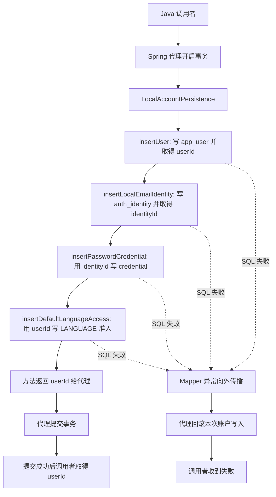

# Identity Account Persistence Flow

- Document Status: `IMPLEMENTED`
- Feature / Slice: `R1-A`
- Last Verified: `2026-10-25`
- Entry: Spring bean `LocalAccountPersistence.createAccountWithLanguageAccess()`；当前由内部注册 Service 和 Java integration test 调用。

## 1. Behavior Boundary

输入为 Identity 内部已规范化邮箱和已编码 password verifier，不是公开注册 HTTP / RPC 接口。
成功创建账户、LOCAL_EMAIL 身份、密码凭据和 LANGUAGE 准入，返回数据库生成的 userId。
不接受外部指定 userId / appCode，不创建 PERSONAL_NOTE 授权、管理员资格、Session 或业务数据。
本事务入口不负责邮箱 / 密码 policy、Argon2、限流、登录或跨服务会话核验。
R1-B 已提供内部密码组件，及先散列再持久化的组合测试，见 [密码处理流程](identity-password-hashing.md)；账户事务本身未改变。
R1-D 已接通 [内部 LOCAL_EMAIL 注册流程](identity-local-registration.md)，邮箱 / 密码规则和安全失败映射在该调用方负责；本事务与 SQL 未改变，2026-10-25 同候选的账户 4 项 / Mapper 3 项 / 密码数据库组合 1 项回归 PASS，0 skipped。

## 2. Main Call Chain

图描述当前无外层事务的调用；任一写入失败即走异常分支，后续写入不执行。

`LocalAccountMapper` 通过本服务 XML 执行 SQL，UUID 使用本服务的 PostgreSQL type handler。
事务来自 Spring bean 的外部调用，测试不提供外层事务；外层事务加入 / 传播场景本轮未验证。
提交阶段的基础设施异常不在图中的 SQL 失败分支内，不能无条件推断已经回滚，见失败边界。

## 3. State and Authority

| 状态 | Authority / 约束 |
|---|---|
| 平台账户 UUID | Identity 数据库生成 UUIDv7；与业务服务固定 userId 关联的未来合同不同于本次实际接入 |
| 邮箱登录身份 | Identity；`(provider, provider_subject)` 唯一约束裁决并发重复 |
| password verifier | Identity；只存编码结果，存储 CHECK 不证明密码 policy 或真实 Argon2 验证 |
| 默认应用准入 | Identity；Mapper 固定写 LANGUAGE，不接收任意 appCode |
| 四表原子性 | Spring 本地事务与同一 Identity 数据库共同保证，不依赖跨库事务 |

所有外键在 Identity 库内；Language / PersonalNote 不能直接使用本服务的 Entity、Mapper 或账户数据库。
本流程不读写 languageProfileId、学习 Evidence / Memory 或长期能力状态，也不调用模型或传递 BYOK。
verifier、邮箱和可能包含它们的异常链不得直接打印；当前事务方法没有异常打印或重试。

## 4. State Transition

- 成功：无本次账户记录 → 四部分数据一起提交。
- 写入失败：本次未提交的部分写入 → 全部回滚，不留下孤立 app_user。
- 默认准入只属于新账户创建；当前方法不会在登录时调用，后续登录不得补回撤销的授权。
- 此 slice 尚无停用、授撤权、账号删除或管理员状态转换。

## 5. Failure / Rejection Paths

| 条件 | 当前结果与证据边界 |
|---|---|
| 并发相同邮箱 | 唯一约束使一个成功、一个 DuplicateKeyException；失败请求此前写入的 app_user 回滚 |
| 凭据写入实际 SQL 失败 | DataAccessException 向外传播，账户和身份写入回滚 |
| 默认 LANGUAGE 授权实际 SQL 失败 | 包括凭据在内的本次写入全部回滚 |
| 参数不满足完整公开注册 policy | 不属于当前入口；本次仅接受内部预处理后的参数，不能据此开放客户端 hash 注册 |
| 提交确认丢失 / 数据库故障 | NOT_RUN；可能为 UNKNOWN，不自动重放创建，不宣称所有提交异常都已回滚 |

## 6. Verification Evidence

FRESH 当前候选：HTTP 9、Mapper / schema / 账号边界 5、用户事务 4，共 18/18 PASS，0 skipped，package PASS。

- `LocalAccountPersistenceIntegrationTests.commitsExactlyOneCompleteAccountWithLanguageAccess`
- `LocalAccountPersistenceIntegrationTests.concurrentDuplicateEmailLeavesOneCompleteAccountAndNoOrphanUser`
- `LocalAccountPersistenceIntegrationTests.failureDuringCredentialOrGrantInsertRollsBackTheWholeAccount`：凭据 / 授权两个样本。
- `IdentityMapperIntegrationTests`：四次 SQL、UUIDv7、唯一约束、verifier 存储、库表边界与专用账号权限。
- `IdentityBoundaryHttpTests`：仅健康检查开放，伪造身份无效，写请求拒绝且无 Session。
- 两个真实 JVM 使用同一 JAR 和隔离 PostgreSQL 18.6；启动前及两次启动后四表逐行脱敏摘要一致。
  写入由 production bean 完成，跨启动读取使用 identity_app 的 SQL，没有公开账户读取 API。

详细运行证据、版本、历史失败和 NOT_RUN 范围见 [R1-A Verification](../features/IDENTITY.md#verification)。
这些证据不证明生产部署、Session、Dubbo 或整个 R1 迁移完成。

## 7. Source References

- `services/identity/src/main/java/com/dailylanguage/identity/account/LocalAccountPersistence.java`
- `services/identity/src/main/java/com/dailylanguage/identity/account/LocalAccountMapper.java`
- `services/identity/src/main/resources/mapper/LocalAccountMapper.xml`
- `services/identity/src/main/resources/db/migration/V1__create_identity_accounts.sql`
- `services/identity/src/main/java/com/dailylanguage/identity/persistence/PostgreSqlUuidTypeHandler.java`
- `services/identity/src/test/java/com/dailylanguage/identity/account/LocalAccountPersistenceIntegrationTests.java`
- `services/identity/src/test/java/com/dailylanguage/identity/account/IdentityMapperIntegrationTests.java`
- `services/identity/src/test/java/com/dailylanguage/identity/security/IdentityBoundaryHttpTests.java`
