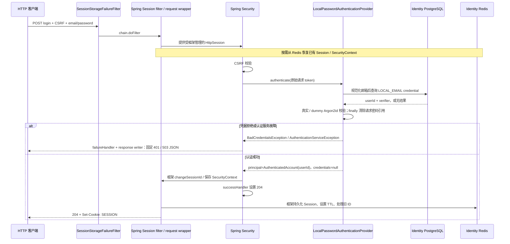

# Identity HTTP Authentication and Session Lifecycle Flow

- Document Status: `IMPLEMENTED`
- Feature / Slice: `R1-G`
- Last Verified: `2026-10-30`
- Entry: `POST /api/auth/login`、`GET /api/auth/me`、`POST /api/auth/logout`

## 1. Behavior Boundary

Identity 在本地 HTTP 上通过 Spring Security form login / logout 与 Spring Session 完成认证和会话生命周期。
账户与 verifier 来自独立 PostgreSQL，认证 Session 来自独立 Redis；不在 Controller 手写认证或会话存取。

| 请求 | 输入与前置条件 | 成功结果 |
|---|---|---|
| login | form-urlencoded email / password；有效 CSRF Cookie 与 X-XSRF-TOKEN | 204，无跳转；已有有效匿名 Session 的 ID 轮换，最小认证身份写入 Redis，返回 SESSION Cookie |
| me | 有效认证 SESSION Cookie | 200，仅返回服务端 principal 中的 userId；请求 Header 中的 userId 不具 authority |
| logout | POST 与有效 CSRF | 204；当前 Session 失效、Cookie 过期，其他 Session 保留；匿名重复 logout 仍可 204 |

安全 GET（例如 health）可生成供 SPA 回传的 XSRF-TOKEN；该 Cookie 可读，认证 SESSION Cookie 仍为 HttpOnly。
本地成功链测试显式关闭 Secure；部署默认 Secure 保持开启，尚无 Hosted HTTPS 或浏览器验收。
注册、应用准入判断、跨服务身份核验、账号启停、限流、前端和生产部署均不在本 Flow。

## 2. Main Call Chain

成功 handler 中的 `setStatus(204)` 只设置状态码，不独立证明 Redis 保存成功。
外层 SessionStorageFailureFilter 包围 Spring Session 的请求处理与保存边界，已知存储失败且响应未提交时改写为固定 503。
失败可能发生在部分写入后；本流程不自动重试，不声称 503 一定意味着没有写入。

后续请求的调用链：

- me：Cookie → Spring Session 从 Redis 恢复 SecurityContext → Spring Security 验证已认证 → CurrentAccountController 读取 AuthenticatedAccount → `{userId}`。
- logout：CSRF 校验 → 框架 logout handler 清除 Authentication、invalidate 当前 HttpSession → Spring Session 删除当前会话并发出过期 Cookie → 204。
- 旧 Cookie：对应 Session 已失效时，不能恢复认证，me 返回固定 401 UNAUTHENTICATED。

## 3. State and Authority

| 对象 | 读取 | 修改 authority |
|---|---|---|
| PostgreSQL 账户 / verifier | Provider 经 Mapper 读取 LOCAL_EMAIL 凭据 | login 不新增账户、不改密码、不恢复撤销的 app_access_grant |
| 认证结果 | Java 同时判断账户存在与密码匹配 | 仅 userId principal；credentials=null、authorities 为空；认证不代表应用授权 |
| SecurityContext / Session | 框架从 Redis 恢复 | Spring Security / Spring Session 负责建立、轮换、保存与失效；Controller 与错误 handler 不手写这些操作 |
| Redis 属性 | SecurityContext、最小身份和框架 metadata | 复用 JSON serializer、精确类型许可、独立 namespace v2 与 24h idle TTL；principal 位于 account/domain |
| 客户端 userId | 不作为身份依据 | me 只读已认证 principal |

Session Cookie 配置为 SESSION / HttpOnly / Secure（本地 HTTP 验收显式例外）/ SameSite=Lax / Path=/，无 Domain / Max-Age 配置。
本流程不调用 LLM、不读取 languageProfileId、Evidence / Memory 或 BYOK，也不修改学习状态。

## 4. Failure / Rejection Paths

| 情况 | 行为与已验证边界 |
|---|---|
| CSRF 缺失 / 不匹配 | 写请求 403；不进入成功认证路径 |
| 凭据拒绝 | failureHandler 调用 writeInvalidCredentials，401 INVALID_CREDENTIALS |
| AuthenticationServiceException | 调用 writeAuthenticationUnavailable，503 AUTHENTICATION_UNAVAILABLE；HTTP 测试的服务故障样本来自 test-only Provider |
| 匿名 / 已失效 Session 调用 me | 401 UNAUTHENTICATED；伪造 X-User-Id 不建立身份 |
| Redis 连接不可用 | 真实不可用地址验证登录保存 / me 恢复返回固定 503，不回退 JVM repository；故障测试的成功认证为 mock |
| QueryTimeoutException / Redis SerializationException | 源码将其纳入同一已知存储故障转换；本轮未逐项注入这两类异常 |
| 已提交响应 / 非捕获 RuntimeException | 源码继续抛出，不伪装成可改写的 503；本轮未单独故障注入 |

错误 writer 只接受固定 code，设置 no-store / nosniff，不将原始异常正文、cause、密码、SQL 或 Redis 地址写入响应。
Session 不存在 / 退出失效已验证；未等待 24h 来验证实际超时过期，也未证明故障后的提交确认状态或自动回滚。

## 5. Verification Evidence

2026-10-30 两批独立运行，均 0 failures / errors / skipped；不能描述成一次 94 项命令：

| 批次 | 结果与证明 |
|---|---|
| 修正后 HTTP / Session：17/17 | IdentityAuthenticationHttpIntegrationTests 1：真实注册组件准备合成账户后，经 HTTP 登录、已有匿名 Session ID 轮换、旧 Redis ID 消失、认证恢复、空 credentials、me 忽略伪造 Header、logout 当前会话、旧 Cookie 拒绝及匿名重复 logout |
| 同批 HTTP 边界 / Session 基础 | IdentityBoundaryHttpTests 11、RedisSessionIntegrationTests 1、RedisSessionUnavailableIntegrationTests 2、SessionSerializationTests 2：CSRF / 拒绝、安全错误合同、真实 Redis 存取 / TTL、类型许可与不可用路径 |
| 其余 Identity 回归：77/77 | 67 项组件 / Service / Provider 与 10 项真实数据库事务、Mapper、注册 / 密码组合；Flyway 在独立空 schema 执行 V1 |

原始第一批为 16 PASS / 1 failure；根因是测试手造 Cookie 的 domain / version 与服务端响应不一致，产生重复 SESSION 并误取旧值。
在不改生产代码的真实服务诊断中，改按 Set-Cookie 解析匿名样本后，旧 Redis ID 消失、新 ID 存在，me=200。
用户批准只修正测试输入；保留全部原断言，并增加 SESSION Cookie 唯一性断言，随后原测试通过。
其他会话保留通过同账户的另一个合成认证 Session 验证，不扩大为两个设备各自完整登录的验收。

PostgreSQL 18.6、Redis 7.2.16，一次性 loopback-only / tmpfs 实例；随机凭据仅在运行时使用，密码计算容量保持 1。
两批 package（跳过已完成测试）退出 0；JAR 包含四个 R1-G 组件及 Spring Session / Data Redis 4.1.1、Lettuce 7.5.2.RELEASE。
生产源码未改，用户 handler blob 保持 `8a5122fd15ae10ff9c2a3d1c2427492074cecb6d`。
测试 trigger 和 Redis key 遗留均为 0，全部本轮容器已清理；未操作既有业务库 / 卷、未执行 FLUSHDB / FLUSHALL。

证据目录：`services/identity/target/r1g-20261030-focused-fixed/` 与 `services/identity/target/r1g-20261030-remaining-regression/` 的日志、JUnit XML 和 summary.json；失败及两次诊断证据保留在相邻目录。
详细批次、命令与 Ownership 边界见 [R1-G 合同](../features/IDENTITY.md#r1-g--http-认证与-session-生命周期)。

## 6. Source References

2026-10-30 首批 security 分层后，用户进一步批准全部功能分层及 principal 类型迁移：当前为 account/domain/AuthenticatedAccount，Session namespace v2。旧 v1 会话不恢复，用户需重新登录；账户数据不变，旧键依 TTL 过期。完整目录下 HTTP / Session 18/18 与其余 Identity 77/77 两批 FRESH PASS、package PASS，JAR 无旧类型路径残留；最新增量与兼容性决定见 Feature 的完整分层记录。上节原始 17 / 77 两批保留历史范围，不冒充新一批结果。

- [IdentitySecurityConfiguration](../../services/identity/src/main/java/com/dailylanguage/identity/security/config/IdentitySecurityConfiguration.java)：端点、CSRF、IF_REQUIRED、changeSessionId、form login / logout 与 handler。
- [LocalPasswordAuthenticationProvider](../../services/identity/src/main/java/com/dailylanguage/identity/account/infrastructure/LocalPasswordAuthenticationProvider.java) 与 [Provider Flow](identity-local-authentication.md)：真实 / dummy 校验、最小身份、故障分类与凭据清理。
- [SessionConfiguration](../../services/identity/src/main/java/com/dailylanguage/identity/security/config/SessionConfiguration.java)、[application.yml](../../services/identity/src/main/resources/application.yml) 与 [存储 Flow](identity-session-storage.md)：框架 Session / serializer / Redis / Cookie 配置。
- [CurrentAccountController](../../services/identity/src/main/java/com/dailylanguage/identity/security/api/CurrentAccountController.java)：只读已认证 userId。
- [SessionStorageFailureFilter](../../services/identity/src/main/java/com/dailylanguage/identity/security/infrastructure/SessionStorageFailureFilter.java) 与 [AuthenticationHttpResponseWriter](../../services/identity/src/main/java/com/dailylanguage/identity/security/infrastructure/AuthenticationHttpResponseWriter.java)：外层故障边界、提交状态与固定响应。
- [IdentityAuthenticationHttpIntegrationTests](../../services/identity/src/test/java/com/dailylanguage/identity/account/infrastructure/IdentityAuthenticationHttpIntegrationTests.java)：真实 HTTP / PostgreSQL / Redis 成功闭环与 Cookie 回归。
- [IdentityBoundaryHttpTests](../../services/identity/src/test/java/com/dailylanguage/identity/security/infrastructure/IdentityBoundaryHttpTests.java)、[RedisSessionUnavailableIntegrationTests](../../services/identity/src/test/java/com/dailylanguage/identity/security/infrastructure/RedisSessionUnavailableIntegrationTests.java)：拒绝与故障证据。
