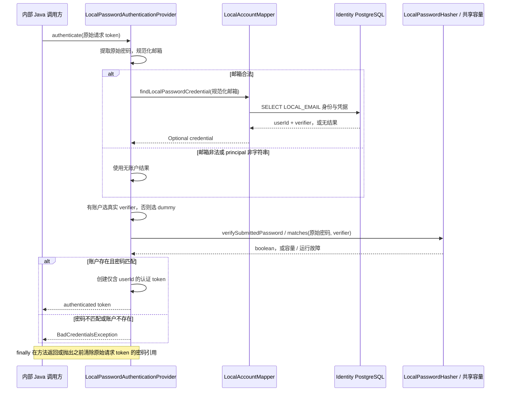

# Identity Local Authentication Flow

- Document Status: `IMPLEMENTED`
- Feature / Slice: `R1-E`
- Last Verified: `2026-10-25`
- Entry: Identity 内部 Spring bean `LocalPasswordAuthenticationProvider.authenticate(authenticationRequest)`。

## 1. Behavior Boundary

内部调用方提交 UsernamePasswordAuthenticationToken，principal 为原始邮箱，credentials 为原始密码。
Provider 读取 LOCAL_EMAIL credential，校验密码后返回认证 token；principal 仅为 AuthenticatedAccount(userId)，
credentials 为 null、authorities 为空。凭据有效不等于获得应用准入。

当前 Spring 已发现该 Provider，但没有公开登录 HTTP / RPC 入口；安全配置仍关闭 formLogin / httpBasic，
健康检查之外的普通请求全部拒绝，不创建 Session。应用授权、账号启停、Redis、Rate Limit、业务消费者和前端不在本 Slice。
登录不执行注册 password policy / blocklist，不 trim 或改写有效密码。

## 2. Main Call Chain

组件创建时先通过已有 LocalPasswordHasher.hash 生成一次合法 dummy verifier，保存在进程内；
失败记录 DUMMY_INITIALIZATION stage 与 exception type，并拒绝创建组件，不用无效 verifier 降级。

数据库查询或密码校验故障会抛出 AuthenticationServiceException，不进入后续成功 / 凭据拒绝判断；finally 仍执行。
unsupported token 类型直接返回 null 交由其他 Provider 处理，不属于图中的受支持请求清理路径。
非 CharSequence credentials 转为空字符串参与验证。未知 / 非法邮箱执行 dummy 校验，dummy 匹配也不产生身份。
dummy 补齐同类受限密码计算，不代表本流程已证明恒定耗时或生产防枚举效果。

## 3. State and Authority

| 对象 / 阶段 | 读取与计算 | 状态变化与权限 |
|---|---|---|
| 邮箱 | 复用 LocalEmailNormalizer 的 ASCII / 格式规则、strip 与 Locale.ROOT 小写化 | 不查询 DNS，不确认邮箱所有权 |
| 凭据查询 | auth_identity JOIN local_password_credential，以 provider=LOCAL_EMAIL 与规范化 subject 查找 | 只读，不查询或修改 app_access_grant，不新开账户事务 |
| 密码 | 原始 CharSequence 与真实 / dummy verifier | 复用固定 Argon2id 参数及 hash / matches 共享容量，验证结束归还名额 |
| 身份产生 | 账户存在性和密码匹配结果 | Java 同时检查两项条件；不由 dummy 计算结果推断账户存在 |
| 成功 token | 数据库 userId | 不携带邮箱、密码、verifier 或应用权限；不保存到 SecurityContext / Session |
| 原始请求 | loginRequest | finally 调用 eraseCredentials；只解除 token 引用，不声称擦除 JVM String |

LocalPasswordCredential 仅供 Identity 内部使用，toString 隐去 verifier；AuthenticatedAccount 只持有 userId。
Provider 不能授予或恢复 LANGUAGE / PERSONAL_NOTE 准入，账号启停也不是当前 schema 的能力。
本流程不调用 LLM，不访问 languageProfileId、学习 Evidence / Memory 或 BYOK，不改变长期学习状态。

## 4. Failure / Rejection Paths

| 情况 | 对调用方结果 | 日志与后续行为 |
|---|---|---|
| 非字符串 principal、非法邮箱或未知账户 | BadCredentialsException / Invalid credentials | 仍执行 dummy 校验；非法邮箱不查询数据库，不记录输入错误日志 |
| 账户存在但密码不匹配 | 同一 BadCredentialsException / Invalid credentials | 不返回身份；不把预期拒绝归为服务故障 |
| 存储 verifier 格式 / 参数不受现有 hasher 支持 | hasher 返回 false，转凭据拒绝 | 不改变已有 hasher 合同，不以存储值提高计算成本 |
| Mapper RuntimeException，包括 IllegalArgumentException | AuthenticationServiceException / Local authentication unavailable | 只记 ACCOUNT_LOOKUP stage 和 exception type，不执行密码校验 |
| 密码校验容量不足 | 同一 AuthenticationServiceException | 立即拒绝，不等待、不记录 ERROR，不转换成密码不匹配 |
| 密码校验其他 RuntimeException | 同一 AuthenticationServiceException | 只记 PASSWORD_VERIFY stage 和 exception type |
| dummy 初始化 RuntimeException | 拒绝创建 Provider | 只记 DUMMY_INITIALIZATION stage 和 exception type |

邮箱规范化与 Mapper 调用处于不同 catch 范围，数据库的输入 / 映射故障不会被误判为邮箱非法。
对外异常消息固定，不附带原始 cause；日志不包含原始邮箱、密码、verifier、SQL 参数或异常正文。
所有受支持请求的成功 / 拒绝 / 运行故障路径都经过 finally 清除请求密码。

## 5. Verification Evidence

2026-10-25 两批 fresh 证据，均基于 Provider blob `2476e0afd6af9da71f5f82f159532814991f7bf9`：

- 组件 / Service / Provider / HTTP：76/76 PASS，0 failures / errors / skipped，package 退出码 0。
- PostgreSQL 18.6 组合与账户回归：10/10 PASS，0 failures / errors / skipped，package 退出码 0。

Human Review 收口时当前 Provider blob 为 `3fc6e7749ced047c5d635889ffad2b4f6c68ae25`，与上述验收版逐 blob 对比仅删除骨架说明、无逻辑变化；本次未重跑测试，上述运行证据保留为同日 PRIOR。

| 测试 | 证明范围 |
|---|---|
| LocalPasswordAuthenticationProviderTests，11 项 | 原始密码和规范化邮箱、最小成功身份、统一凭据拒绝、dummy 即使匹配也不能产生身份、Mapper 异常分类、hasher 故障 / 容量、安全日志 / cause、凭据清理、初始化失败与凭据描述脱敏；使用 mock，不证明真实数据库 |
| IdentityPasswordHashingIntegrationTests，2 项 | 既有真实 verifier 往返；新增真实注册 → Mapper constructor mapping / Optional → Provider / Argon2 认证，认证后撤销的应用准入不恢复且 verifier 不变 |
| LocalRegistrationIntegrationTests，1 项 | 真实注册、密码空格保留和 hash 在事务外；账户创建行为未修改 |
| LocalAccountPersistenceIntegrationTests，4 项；IdentityMapperIntegrationTests，3 项 | 既有账户提交 / 并发唯一冲突 / SQL 失败回滚与 schema / 专用账号权限回归 |
| 其余组件 / Service / HTTP，65 项 | 既有 normalizer、policy、blocklist、hasher、真实容量、注册安全边界与 HTTP 拒绝回归；不扩大为公开登录验收 |

数据库使用既有初始化 SQL、新建隔离标识库与非集群管理员 identity_app；显式启用数据库测试，密码容量保持 1，从空 schema 运行 Flyway V1。
验证后 app_user / auth_identity / local_password_credential 各 5 行，app_access_grant 4 行（认证组合有意撤销一条准入），Flyway 成功记录 1 条、测试 trigger 遗留 0。
一次性容器及 tmpfs 已清理，随机凭据未输出或保存；Provider blob 前后相同，未修改用户核心实现。

这两批不混写为一次命令运行。详细命令与脱敏证据入口见 [R1-E 合同](../features/IDENTITY.md#r1-e--内部-local_email-凭据认证)。
尚未验证独立 JAR 进程、公开登录 / Session、跨服务、生产容量、防枚举耗时或真实用户场景；测试不代替 Human Review。

## 6. Source References

- [LocalPasswordAuthenticationProvider](../../services/identity/src/main/java/com/dailylanguage/identity/account/LocalPasswordAuthenticationProvider.java)：authenticate、lookupCredential、verifySubmittedPassword、dummy 初始化与 finally。
- [LocalEmailNormalizer](../../services/identity/src/main/java/com/dailylanguage/identity/account/LocalEmailNormalizer.java)：共享邮箱规则。
- [LocalAccountMapper](../../services/identity/src/main/java/com/dailylanguage/identity/account/LocalAccountMapper.java) 与 [SQL / constructor mapping](../../services/identity/src/main/resources/mapper/LocalAccountMapper.xml)：只读凭据查询。
- [LocalPasswordCredential](../../services/identity/src/main/java/com/dailylanguage/identity/account/LocalPasswordCredential.java) 与 [AuthenticatedAccount](../../services/identity/src/main/java/com/dailylanguage/identity/account/AuthenticatedAccount.java)：内部凭据与对外认证身份分离。
- [LocalPasswordHasher](../../services/identity/src/main/java/com/dailylanguage/identity/credential/LocalPasswordHasher.java) 与 [密码 Flow](identity-password-hashing.md)：固定格式、参数与共享容量。
- [Provider tests](../../services/identity/src/test/java/com/dailylanguage/identity/account/LocalPasswordAuthenticationProviderTests.java) 与 [数据库组合 tests](../../services/identity/src/test/java/com/dailylanguage/identity/account/IdentityPasswordHashingIntegrationTests.java)：认证合同与真实组件接通。
- [IdentitySecurityConfiguration](../../services/identity/src/main/java/com/dailylanguage/identity/security/IdentitySecurityConfiguration.java)：现有 HTTP / Session 拒绝边界。
