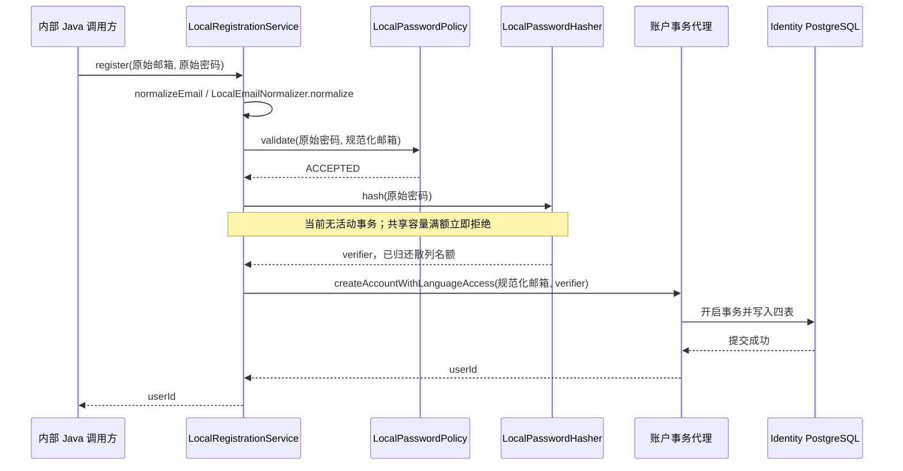

# Identity Local Registration Flow

- Document Status: `IMPLEMENTED`
- Review Sync Status: `CURRENT`
- Feature / Slice: `R1-D`
- Last Verified: `2026-10-25`
- Entry: Identity 内部 Spring bean `LocalRegistrationService.register(submittedEmail, submittedPassword)`。

## 1. Behavior Boundary

接收原始邮箱与原始密码，依次完成邮箱规范化、密码 policy、受限 Argon2id 散列和账户原子持久化。
成功返回 Identity 数据库生成的 userId；只创建 LOCAL_EMAIL 身份及默认 LANGUAGE 准入。
当前调用者为内部 Java 验证代码，没有公开注册 / 登录 HTTP 或 RPC 入口。

正常调用没有外层事务；Service 不添加事务，只有后续独立账户 bean 开启事务。
不接受客户端 verifier、userId、appCode 或管理员资格，不预查询邮箱、不自动重试。
Session、Redis、Rate Limit、Gateway、业务消费者、前端、邮箱所有权验证与恢复均不在本流程。

## 2. Main Call Chain

图展示正常路径；任一 helper 拒绝或失败即抛注册异常，后续阶段不执行。
账户方法返回给 Spring 代理之后还需提交，代理成功返回后 register 才能将 userId 返回调用方。
四表写入、并发唯一冲突和明确 SQL 失败回滚细节见 [账户持久化 Flow](identity-account-persistence.md)。

## 3. State and Authority

| 阶段 | 读取 / 计算 | Authority 与 mutation |
|---|---|---|
| 邮箱规范化 | strip 首尾空白，先检查 ASCII，再用 Locale.ROOT 小写化并检查语法 / 长度 | Java 持有固定规则；不合并 plus / dot、不查询 DNS，不写状态 |
| 密码 policy | 原始密码、规范化邮箱、固定离线 blocklist | Java 校验；不改写密码，不写账户或长期状态 |
| Argon2id | 原始密码、固定安全参数和进程容量 | 共享 gate 立即取得 / 拒绝名额，成功或失败后归还已取得名额；不访问数据库 |
| 账户事务 | 规范化邮箱和 verifier | Spring / Identity PostgreSQL 原子写入 app_user、auth_identity、local_password_credential、app_access_grant |
| 默认准入 | Mapper 固定 LANGUAGE | 不授予 PERSONAL_NOTE / 管理员，不创建语言档案或业务资源 |

Identity 数据库唯一约束持有重复身份的最终裁决权，Service 不维护第二套唯一性判断。
本流程不调用 LLM，不读写 languageProfileId、学习 Evidence / Memory、语言等级或 BYOK。
原始密码不进入 persistence 参数；邮箱、密码、verifier 和原始数据库 cause chain 不写入注册日志。

## 4. Failure / Rejection Paths

| 失败阶段 | 向调用方表现 | 后续执行与状态 |
|---|---|---|
| 邮箱 null / 非法 | INVALID_EMAIL | 不执行 policy、散列或持久化 |
| 密码长度 / 字符 / 弱密码拒绝 | INVALID_PASSWORD_LENGTH / INVALID_PASSWORD_CHARACTER / COMMON_OR_COMPROMISED_PASSWORD | 不执行散列或持久化 |
| policy 意外 RuntimeException | REGISTRATION_FAILED | 只记录 PASSWORD_POLICY stage 与 exception type，不执行后续阶段 |
| 散列容量不足 | REGISTRATION_FAILED | 不等待、不写库、不记录 ERROR；不误报为密码不合规则 |
| 其他散列 RuntimeException | REGISTRATION_FAILED | 只记录 PASSWORD_HASH stage 与 exception type；不进入账户事务 |
| 持久化 DuplicateKeyException | IDENTITY_UNAVAILABLE | 具体分支先处理；异常经过事务代理后转换，不记录底层异常 |
| 其他持久化 RuntimeException | REGISTRATION_FAILED | 只记录 PERSISTENCE stage 与 exception type，不携带原始 cause，不重试 |

LocalRegistrationException 只携带固定 reason / 消息，不保留原始异常链。
IDENTITY_UNAVAILABLE 是当前安全映射，不将所有唯一键冲突都宣称为已精确识别的邮箱冲突；未来唯一键变化时重新评估。
明确 SQL 写入失败时，本次四表写入整体回滚；提交确认丢失可能为 UNKNOWN。
收到 REGISTRATION_FAILED 不代表账户一定不存在，本次没有验证提交确认丢失或实现重放 / 幂等机制。

## 5. Verification Evidence

2026-10-25 / FRESH：一次性 PostgreSQL 18.6，显式启用 IDENTITY_DATABASE_TESTS=true，
使用现有初始化 SQL、非集群管理员 identity_app 和隔离数据库标识；从空 schema 执行 Flyway V1。

| 现有测试 | 实际结果与证明范围 |
|---|---|
| LocalRegistrationIntegrationTests.registersNormalizedEmailAndOriginalPasswordWithHashingOutsideTransaction | 1/1 PASS；真实 Spring Service / policy / Argon2 / 四表事务接通，散列时没有活动事务，密码空格保留，只有 LANGUAGE 授权 |
| LocalAccountPersistenceIntegrationTests | 4/4 PASS；完整提交、并发相同邮箱恰好一个成功且无孤立账户、凭据 / 默认授权 SQL 失败回滚 |
| IdentityMapperIntegrationTests | 3/3 PASS；identity UUIDv7、拒绝明文凭据、schema 与专用账号权限边界 |
| IdentityPasswordHashingIntegrationTests | 1/1 PASS；真实 verifier 落库读回后匹配，错误密码拒绝 |

合计 9/9 PASS、0 failures / errors / skipped，package 退出码 0。
测试后四表各 4 行合成样本，Flyway 成功记录 1 条，测试 trigger 遗留 0；一次性容器及 tmpfs 数据已清理。
凭据仅存在于该次验证进程环境，不输出或持久保存；未连接旧数据库或删除现有卷。

同日上一批 / PRIOR：65/65 组件、Service、HTTP 回归 PASS，0 skipped，package 成功。
其中 Service unit 验证输入 / policy 短路、容量与失败映射、安全日志和不附带 cause；
真实并发与 SQL 失败回滚复用账户事务用例，不在注册层重复注入相同数据库故障。
两批证据来自相同 register blob，不将 74 项描述为一次命令运行。

详细命令及证据见 [Identity R1-D 合同](../features/IDENTITY.md#r1-d--identity-内部-local_email-注册闭环)。
本机忽略的 services/identity/target/r1d-final-verification-summary.json 与 r1d-database-package-verification.log 保存脱敏摘要 / 日志。
上述证据不证明生产容量、公开注册 / 登录、Session、跨服务或提交确认丢失行为。

## 6. Source References

- [LocalRegistrationService](../../services/identity/src/main/java/com/dailylanguage/identity/account/LocalRegistrationService.java)：register、normalizeEmail、validatePassword、hashPassword、logUnexpectedFailure。
- [LocalEmailNormalizer](../../services/identity/src/main/java/com/dailylanguage/identity/account/LocalEmailNormalizer.java)：normalize。
- [LocalRegistrationException](../../services/identity/src/main/java/com/dailylanguage/identity/account/LocalRegistrationException.java)：固定 reason / message。
- [LocalPasswordPolicy](../../services/identity/src/main/java/com/dailylanguage/identity/credential/LocalPasswordPolicy.java)：validate；原有 R1-C 实现未改变。
- [LocalPasswordHasher](../../services/identity/src/main/java/com/dailylanguage/identity/credential/LocalPasswordHasher.java) 与 [PasswordHashConcurrencyGate](../../services/identity/src/main/java/com/dailylanguage/identity/credential/PasswordHashConcurrencyGate.java)：固定散列与共享容量。
- [LocalAccountPersistence](../../services/identity/src/main/java/com/dailylanguage/identity/account/LocalAccountPersistence.java) 与 [SQL Mapper](../../services/identity/src/main/resources/mapper/LocalAccountMapper.xml)：独立事务和四表写入。
- [LocalRegistrationIntegrationTests](../../services/identity/src/test/java/com/dailylanguage/identity/account/LocalRegistrationIntegrationTests.java)、[LocalRegistrationServiceTests](../../services/identity/src/test/java/com/dailylanguage/identity/account/LocalRegistrationServiceTests.java)、[LocalAccountPersistenceIntegrationTests](../../services/identity/src/test/java/com/dailylanguage/identity/account/LocalAccountPersistenceIntegrationTests.java)：真实组合、安全失败和账户事务证据。

## 7. Maintenance Rule

输入规则、失败映射、日志、散列容量与事务顺序、默认准入、公开入口或唯一键语义变化时同步核对本 Flow。
新增公开入口或改变事务 / 权限边界仍需单独 Scope / Architecture Decision，不由本 Flow 授权。
