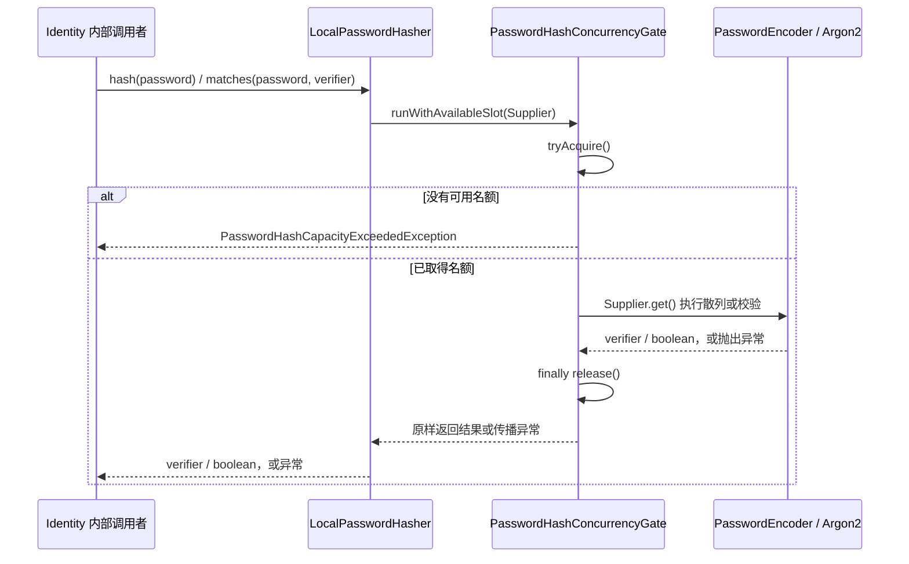

# Identity Password Hashing Flow

- Document Status: `IMPLEMENTED`
- Feature / Slice: `R1-B`
- Last Verified: `2026-10-24`
- Entry: Identity 内部 Spring bean `LocalPasswordHasher.hash()` / `matches()`。

## 1. Behavior Boundary

`hash` 保留原始密码的空格和大小写，以随机 salt、固定 Argon2id 参数生成 `{argon2id-v1}` verifier。
`matches` 检查输入格式和固定参数后校验密码，返回匹配结果。当前没有注册 / 登录 HTTP 或 RPC 入口。
邮箱 / 密码 policy、密码升级、Session、集群限流不在本 slice；组件不访问数据库、不启动事务、不记录密码或 verifier。
R1-D 的 [内部注册调用方](identity-local-registration.md) 已在 hash 前完成邮箱 / 密码 policy，再调用独立账户事务；本组件与容量机制没有改变。
R1-E 的 [内部凭据认证调用方](identity-local-authentication.md) 在组件初始化时生成 dummy verifier，并使用 matches 校验真实 / dummy 凭据；登录不调用注册 policy，hasher 与容量机制不变。

## 2. Main Call Chain

`matches` 对 null 密码或不支持的 verifier 先返回 false，不占容量、不执行 Argon2；`hash(null)` 直接拒绝。
通过前置检查后执行下图。Encoder 为 Spring Security PasswordEncoder，底层通过 Bouncy Castle 执行 Argon2。

`hash` 返回前还检查生成的 verifier 是否符合当前格式；异常格式抛 IllegalStateException。
图中的归还仅属于已成功取得名额的路径；拒绝路径不会执行 Supplier 或归还名额。

## 3. State and Authority

- 散列参数由 Java 固定：Argon2id v19，memory 19456 KiB、iterations 2、parallelism 1、salt 16 bytes、hash 32 bytes。
- verifier 的版本、参数、长度和 canonical Base64 在执行 Argon2 前由 Java 检查，不能由存储值提高计算成本。
- Spring 单例组件让 `hash` / `matches` 共用同一个 Semaphore；`app.security.password-hashing.max-concurrent` 本地默认 1，非正数或非整数启动失败。
- 成功取得名额时可用数量减 1；操作结束后归还一次。false、null、RuntimeException 和 Error 均不改变归还责任。
- 容量不足表示暂时无法执行，不能转换成密码不匹配。本进程容量不等于生产容量结论或集群限流。
- 本流程不调用模型，不读写 languageProfileId、学习状态、Evidence、Memory 或 BYOK。

## 4. Persistence Combination Boundary

组合测试先调用 `hash`，待名额归还后，再调用已有 Spring 事务 bean
`LocalAccountPersistence.createAccountWithLanguageAccess` 保存 verifier；读回后调用 `matches`。
这是 Java integration test 验证的组件组合，不代表已经新增 production 注册流程。
四表原子性仍由 [账户持久化流程](identity-account-persistence.md) 负责，R1-B 没有修改该事务、SQL 或 schema。

## 5. Failure / Rejection Paths

| 条件 | 当前结果 |
|---|---|
| hash 的密码为 null | NullPointerException；不取得名额 |
| matches 的密码为 null，或 verifier 格式 / 参数不支持 | false；不执行 Argon2 |
| 进程容量已满 | 专用容量异常；不等待、不排队、不执行操作、不增加名额 |
| 操作抛异常或 Error | 归还已取得名额，异常原样传播 |
| 账户持久化失败 | 已完成的散列不写状态；账户事务的写入失败继续按已有合同回滚 |

## 6. Verification Evidence

- 同日先前批次：LocalPasswordHasherTests 17/17、PasswordHashConcurrencyGateTests 12/12、IdentityBoundaryHttpTests 9/9，共 38/38 PASS，0 skipped。算法单测使用容量 mock，真实容量行为由 Gate 测试负责。
- 本次 FRESH，提交 `3f0d36f`：独立 PostgreSQL 18.6，空库 Flyway V1 成功；IdentityPasswordHashingIntegrationTests 1/1、IdentityMapperIntegrationTests 5/5、LocalAccountPersistenceIntegrationTests 4/4，共 10/10 PASS，0 skipped。
- 同次 Maven package 退出码 0；独立启动产出 JAR，HTTP `/actuator/health` 返回 UP；随后停止 JVM 并自动移除本次 tmpfs 数据库容器。
- 合成测试验证真实 verifier 数据库往返、重复邮箱并发、凭据 / 授权写入失败回滚，以及专用账号边界；不证明生产容量、完整注册 / 登录、Session 或跨服务授权。
- 详细证据见 [R1-B 合同](../features/IDENTITY.md#r1-b--受限密码散列与校验)。

## 7. Source References

- `services/identity/src/main/java/com/dailylanguage/identity/credential/LocalPasswordHasher.java`
- `services/identity/src/main/java/com/dailylanguage/identity/credential/PasswordHashConcurrencyGate.java`
- `services/identity/src/main/java/com/dailylanguage/identity/credential/PasswordHashCapacityExceededException.java`
- `services/identity/src/main/resources/application.yml`
- `services/identity/src/test/java/com/dailylanguage/identity/credential/LocalPasswordHasherTests.java`
- `services/identity/src/test/java/com/dailylanguage/identity/credential/PasswordHashConcurrencyGateTests.java`
- `services/identity/src/test/java/com/dailylanguage/identity/account/IdentityPasswordHashingIntegrationTests.java`
