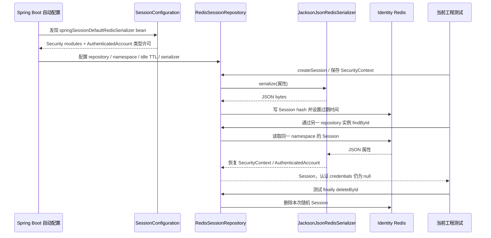

# Identity Session Storage Flow

- Document Status: `IMPLEMENTED`
- Feature / Slice: `R1-F`
- Last Verified: `2026-10-25`
- Entry: Spring Session 自动配置的 RedisSessionRepository；当前真实存取调用方为工程测试。

## 1. Behavior Boundary

为 Identity 提供 Redis-backed Session 存取基础，使用 Boot 管理的 Spring Session / Spring Data Redis 4.1.1。
IdentitySecurityConfiguration 未修改，仍为 STATELESS、关闭 formLogin / httpBasic / logout，当前 HTTP 不创建登录会话。
R1-E authenticate 返回的身份尚未由生产 HTTP 登录入口写入 Session；保存、读取、Cookie 发送、Session ID 轮换、退出与跨服务核验不能混为已实现行为。

配置固定 namespace `daily-language:identity:session:v1`、default 非索引 repository、24h idle TTL，连接 / 操作超时均为 1s。
Identity Redis host 必须显式提供，不回退到旧 Language 地址或 namespace。

## 2. Main Call Chain

第二 repository 的读取验证属性来自 Redis，原实例不承担 JVM 内存会话真相。
未手写 Session ID、Redis key 生命周期、repository、filter 或 @EnableRedisHttpSession。

## 3. State and Authority

- Spring Session 持有 Session ID、属性存取、idle TTL 和删除生命周期；本服务只提供 serializer 与必要配置。
- JSON 配置使用 Spring Security modules 的类型规则，只额外放行 final record AuthenticatedAccount，不按整个业务 package 放宽，也不使用 Java native serialization。
- 调用方应保存 R1-E 已清除 credentials 的最小认证上下文。serializer 不负责清理任意 Session 属性中的敏感字符串，不将类型许可等同于敏感字段过滤。
- Redis 是会话存储，PostgreSQL 仍持有账户、凭据与应用准入；Session 不保存密码 verifier，不恢复被撤销的应用授权。
- Cookie 配置为 SESSION / HttpOnly / Secure / SameSite=Lax / Path=/，Domain 与 Max-Age 未设置；这里只验证配置绑定，尚未验证登录响应实际发送 Cookie。
- 本地 Compose 使用 loopback 与 tmpfs，禁用 RDB / AOF。Redis 重启后会话丢失；这不是生产高可用、传输保护、访问控制或 Redis 持久化设计。
- 本流程不调用 LLM，不读写 languageProfileId、学习 Evidence / Memory 或 BYOK；不创建第二套用户 / 权限真相。

## 4. Failure / Rejection Paths

| 情况 | 当前行为与证据边界 |
|---|---|
| JSON 还原未知业务类型 | 抛 SerializationException，不放宽许可或退回 Java native serialization |
| Redis 连接不可用，repository.save | 抛 DataAccessException；上下文仅有 RedisSessionRepository，无内存 repository fallback |
| Session 不存在或过期 | 由框架 repository 处理；本 Slice 未等待 24h 或执行浏览器过期链路，不据配置和 TTL 读值宣称完整 expiry 验收 |
| 未来登录写 Session 失败 | HTTP 错误映射与成功响应提交边界待后续 Slice；当前没有登录 handler，不声称已返回 503 或完成 Session rotation |

## 5. Verification Evidence

2026-10-25 两批 fresh，均 0 failures / errors / skipped、package 退出码 0：

| 测试 | 结果与证明 |
|---|---|
| SessionSerializationTests | 2/2；SecurityContext + AuthenticatedAccount JSON 往返、认证态 / 空 credentials / 空 authorities、未知业务类型还原拒绝 |
| RedisSessionIntegrationTests | 1/1；真实 Redis 第二 repository 恢复、独立 namespace、24h metadata 与实际 key TTL、Cookie 属性绑定、finally 删除后 key 不存在 |
| RedisSessionUnavailableIntegrationTests | 1/1；独立不可用地址 / 100ms 测试超时，保存抛 DataAccessException，未出现 JVM repository fallback |
| 既有 Identity 组件 / Service / Provider / HTTP | 76/76；现有认证与 HTTP 拒绝仍成立。HTTP 测试仅关闭最小测试上下文的 Redis health，不能据此断言完整服务的 Redis 健康状态 |
| PostgreSQL 新 / 既有账户认证组合 | 10/10；新增 Session 依赖后，现有真实注册 / 认证、账户事务 / 并发 / 回滚与库表权限回归通过 |

第一批合计 80/80，第二批数据库 10/10，不写成单次 90 项命令。
Redis 使用 7.2.16 官方镜像，digest `sha256:f8548b29a1f1cb358b5fcfec1e0126beab57ad15776c1e87623f865579f16c5a`；测试键遗留 0。
PostgreSQL 18.6 使用既有隔离标识、identity_app 与空 schema Flyway V1，密码容量保持 1。
两个新建容器及 tmpfs 均已清理，无 FLUSHDB / FLUSHALL，无旧库 / 既有卷操作；R1-E Provider blob 保持 3fc6e7749ced047c5d635889ffad2b4f6c68ae25。
详细命令 / 脱敏结果见 [R1-F 合同](../features/IDENTITY.md#r1-f--redis-session-基础) 与 [本地环境](../../deploy/local/identity/README.md#r1-f-redis-session-基础)。

## 6. Source References

- [SessionConfiguration](../../services/identity/src/main/java/com/dailylanguage/identity/security/SessionConfiguration.java)：固定 serializer bean 与精确业务类型许可。
- [application.yml](../../services/identity/src/main/resources/application.yml)：独立 Redis / namespace、timeout、TTL 与 Cookie 配置。
- [POM](../../services/identity/pom.xml)：Boot-managed Session Redis starter；JAR 核对 Session / Data Redis 4.1.1、Lettuce 7.5.2.RELEASE。
- [IdentitySecurityConfiguration](../../services/identity/src/main/java/com/dailylanguage/identity/security/IdentitySecurityConfiguration.java)：现有 HTTP 与 STATELESS 边界，未修改。
- [SessionSerializationTests](../../services/identity/src/test/java/com/dailylanguage/identity/security/SessionSerializationTests.java)、[RedisSessionIntegrationTests](../../services/identity/src/test/java/com/dailylanguage/identity/security/RedisSessionIntegrationTests.java)、[RedisSessionUnavailableIntegrationTests](../../services/identity/src/test/java/com/dailylanguage/identity/security/RedisSessionUnavailableIntegrationTests.java)：三组代表性证据。
